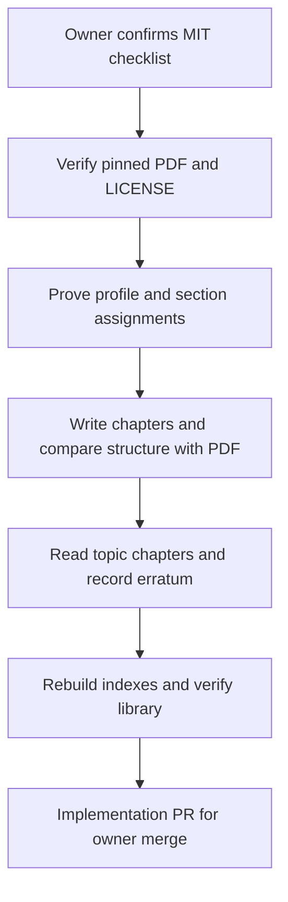

# Hermes Agent 2.0 mirror - Plan

## Goal Capsule

- **Objective**. Readers and agents can resolve, read, and cite the English Hermes Agent 2.0 sections through the library.
- **Means**. Mirror the pinned PDF through the existing `ingest-book` workflow and connect read chapters to the five existing Hermes topics.
- **Authority**. Issue #3 supplies the requirements. `AGENTS.md`, `MAINTAINING.md`, and `.agents/skills/ingest-book/SKILL.md` govern ingestion and owner approval. The original library plan supplies the follow-up boundary.
- **Execution**. One implementation PR contains the book, topic references, existing test expectation updates, live status prose, and rebuilt indexes. The owner merges it.
- **Stop conditions**. U1 is waiting on the owner. A digest mismatch or fidelity failure blocks publication. This planning change ends with a pushed plan branch and an updated issue.

---

## Product Contract

### Summary

Mirror English `v260607` as 21 machine-extracted chapters after the owner accepts the recorded MIT evidence. Record the identifiable section 03 erratum in frontmatter and retain the older-edition notice. Add chapter references to the existing Hermes topics, checking Agent Security first.

### Problem Frame

The library currently has nine mirrored Loop Engineering chapters. Hermes has an eligible catalog record but no chapter text. Agent Security has zero mirrored chapter references. The original library plan deferred Hermes ingestion as the next book.

### Requirements

**Approval and provenance**

- R1. The owner must complete the unchecked MIT setup item before ingestion begins, reviewing both MIT records against their permalinks and accepting the adapted text for this library.
- R2. Use the English `v260607` PDF and LICENSE at commit `b6e53a8e11e00c8b14b2f72d6b4f1ce71fef6692`, with their recorded digests verified before use.
- R3. Submit the mirror status change and all book files together in one PR for owner approval.

**Chapters and notices**

- R4. Produce one faithful Markdown chapter per source section, with permanent number-free slugs and source-derived frontmatter.
- R5. Keep all 21 chapters `machine-extracted` and visibly disclose that no person has compared them with the PDF.
- R6. Preserve the notice that English `v260607` predates Chinese `v261020`, expose `edition_behind`, and record the section 03 erratum without applying it to the source text.

**Discovery and verification**

- R7. Add references to the five existing Hermes topics only after reading each referenced chapter in full, starting with Agent Security.
- R8. Pass ingestion fidelity, whole-library validation, topic citation checks, generated-file freshness checks, existing regression tests, and book/chapter resolution.
- R9. Update hand-written counts, live status prose, and existing data expectations to agree with the second mirrored book.

### Scope boundaries

This milestone uses the existing PDF reader, schemas, license gate, and ingestion commands. It adds book data and the factual changes needed to expose that data through existing entry points.

#### Deferred to Follow-Up Work

- Issue #4 owns human review and behavioral evals.
- Issue #5 owns 12-factor-agents and a second collection.
- Issue #6 owns license evidence for the 17 reference-only books.
- Chinese-edition ingestion remains deferred by the original plan.

### Owner decisions

1. **Waiting before U2**. The MIT checklist item is unchecked in both the checkout and GitHub's default-branch `MAINTAINING.md` on 2026-11-24. Only the owner can confirm acceptance and tick it. Agent research and a matching digest do not supply that approval.
2. **Waiting at delivery**. The owner decides whether to merge the implementation PR, including its machine-extracted text, permanent slugs, and erratum. Human-reviewed status belongs to issue #4.

---

## Planning Contract

### Key Technical Decisions

- KTD1. **Keep the existing source pin**. Planning downloaded the pinned PDF to temporary storage and confirmed SHA-256 `250eaee552121313db913893404b9b1574c7f2ea7b06d25e8641054a51642d59`. Implementation verifies it again. The LICENSE must have Git blob SHA `ee690880bf3c5d502623b427ce7e21381b0c986f`. Its download and verification remain U2 work. Governs R2.
- KTD2. **Use a book-specific extraction profile**. The 104-page PDF shares the existing pipeline's typography conventions, with an extra heading size and diagram text at the section-label size. The profile below separates them by indent. Governs R4.
- KTD3. **Assign all slugs before writing chapters**. Match each assignment's `title` to the full title produced by extraction, including wrapped title lines. Obtain `part` from the PDF contents. The mapping below fixes the chosen slugs. Governs R4.
- KTD4. **Record the section 03 erratum**. The affected passage is identifiable on PDF page 13. Related diagram, table, and concluding claims occur on pages 13–15 within section 03, whose source range is 12–16. Add an editorial `description` and a pinned README `source_url` to that chapter's `errata`. Retain the printed wording. Governs R6. [Upstream errata](https://github.com/alchaincyf/hermes-agent-orange-book/blob/b6e53a8e11e00c8b14b2f72d6b4f1ce71fef6692/README.md#errata)
- KTD5. **Concentrate topic additions on ten chapters**. The topic mapping below selects two chapters per existing topic. Full chapter reads and citation validation precede publication of each reference. Governs R7.
- KTD6. **Keep delivery atomic**. Validation rejects extra files under an eligible book, so set `mirror_status: mirrored` with the source, LICENSE, profile, and chapters on the implementation branch. Preserve the recorded evidence, permissions, and allowlist. Governs R3.

### Extraction profile

All sizes below are the unscaled values consumed by `kb.pdf_spans.read_pdf`, rounded within the classifier's 0.1 tolerance. Rules run in order. Indent is the left edge of the whole line as grouped by the extractor.

| Order | Role | Font size | Indent restriction |
| --- | --- | --- | --- |
| 1 | `section-label` | 24.0 | `max_indent: 48.0` |
| 2 | `body` | 24.0 | `min_indent: 48.0` |
| 3 | `section-title` | 26.7 | None |
| 4 | `lede` | 15.3 | None |
| 5 | `heading` | 17.3 | None |
| 6 | `heading` | 14.7 | None |
| 7 | `body` | 14.0 | None |
| 8 | `kicker` | 13.3 | `max_indent: 48.0` |
| 9 | `quote` | 13.3 | `min_indent: 48.0` |
| 10 | `table-header` | 11.3 | None |
| 11 | `table-cell` | 12.7 | None |
| 12 | `code` | 12.0 | None |

Use `section_start: '^§\d{2}$'`. Exclude pages `[1, 2, 3, 104]`, the cover, two contents pages, and back cover. Content occupies pages 4–103. Start `accepted_differences` empty.

Section labels start at x=41.25. Diagram arrows and connectors at 24.0 have separate baselines whose line indents exceed 112, so the second rule preserves them as content. The observed 14.66 size supplies lower-level headings. The 11.33 size also occurs in Chinese callout labels and recommendation panels, so those blocks need structural comparison against their PDF pages. Diagram reading order and table reconstruction need the same comparison.

These values come from PDF inspection. Planning has not run ingestion. U3 must prove 21 sections, zero unmatched spans, and no proposed slugs before U4 writes chapters. A draft command's zero exit code alone does not prove those conditions. Refine rules against source pages if that proof fails.

### Section assignments

The table records proposed permanent slugs and observed one-based PDF ranges. These become chapter IDs only after ingestion and index generation. The library does not yet hold this book's text. Its official source is linked below. [Official book](https://www.huasheng.ai/orange-books/hermes-agent/)

| Section | Part | PDF pages | Slug |
| --- | --- | --- | --- |
| 01 | 1 | 4–7 | `meet-hermes` |
| 02 | 1 | 8–11 | `one-brain-many-faces` |
| 03 | 1 | 12–16 | `why-nous-built-this` |
| 04 | 2 | 17–21 | `three-engines-of-self-improvement` |
| 05 | 2 | 22–26 | `curator-brakes-for-self-evolution` |
| 06 | 2 | 27–30 | `what-not-to-learn` |
| 07 | 3 | 31–35 | `three-layers-of-memory` |
| 08 | 3 | 36–39 | `session-search` |
| 09 | 3 | 40–44 | `skill-system-and-open-standards` |
| 10 | 3 | 45–48 | `commanding-a-swarm-of-agents` |
| 11 | 4 | 49–54 | `tools-and-exposure-on-demand` |
| 12 | 4 | 55–59 | `mcp-in-two-directions` |
| 13 | 4 | 60–64 | `platforms-and-self-growing-gateway` |
| 14 | 4 | 65–68 | `three-ways-to-talk` |
| 15 | 5 | 69–72 | `delegate-task-to-kanban` |
| 16 | 5 | 73–76 | `dumb-core-userspace-decoration` |
| 17 | 5 | 77–82 | `collaboration-patterns-and-cost-control` |
| 18 | 6 | 83–88 | `deployment` |
| 19 | 6 | 89–93 | `operating-system-boundary` |
| 20 | 6 | 94–98 | `promptware-defense-and-observability` |
| 21 | 6 | 99–103 | `limits-of-self-improvement` |

Filenames retain source order as `NN-<slug>.md`. Assignments use exact extracted section headings, which can differ from contents-page labels. Slugs exclude section numbers and version numbers so citations survive later reordering.

### Topic assignments

These are implementation read targets. Each reference uses `resource`, the resolved full chapter ID, and a one-sentence editorial `note`. Write notes from the full chapter, then check their citations. The topic's existing editorial scope paragraph remains the scope authority.

| Read order | Topic file | Sections to read and reference |
| --- | --- | --- |
| 1 | `topics/agent-security.md` | 19, 20 |
| 2 | `topics/harness-engineering.md` | 04, 05 |
| 3 | `topics/memory-and-state-management.md` | 07, 08 |
| 4 | `topics/tool-use-and-integration.md` | 11, 12 |
| 5 | `topics/agent-orchestration.md` | 15, 16 |

Replace each Hermes resource-only pointer with the selected chapter references. Remove or replace Agent Security's obsolete no-coverage sentence. Preserve existing Loop references and other books' catalog-only pointers. Update the five hand-written counts in `topics/index.md` and the matching expectations in `tests/test_topics.py`.

### Delivery flow

### Execution-time details

Exact structural repairs and accepted differences depend on the drafts. Record each repair with its source page in the implementation PR. An accepted difference needs a comparison with the rendered page and a page-naming reason. Keep upstream corrections in errata frontmatter.

---

## Implementation Units

### U1. Owner accepts the MIT evidence

**Goal**. Clear R1. This unit is waiting on the owner and precedes every ingestion unit.

**Dependencies**. None.

**Files**. `MAINTAINING.md`, with read-only comparison of both MIT book records and their pinned license permalinks.

**Approach**. The owner reads both license records, confirms the adapted MIT wording is acceptable for this library, and ticks the setup item. If the owner declines, stop and return the issue for a policy decision.

**Verification**. The owner has recorded acceptance. An agent leaves the checkbox for that owner action.

**Test expectation**. None. This is a human approval.

### U2. Prepare and verify the pinned book files

**Goal**. Establish the provenance required by R2–R3 through KTD1 and KTD6.

**Dependencies**. U1.

**Files**. `books/hermes-agent-orange-book/metadata.yaml`, `books/hermes-agent-orange-book/source/Hermes-Agent-The-Complete-Guide-v260607.pdf`, `books/hermes-agent-orange-book/LICENSE`.

**Approach**. Start from an eligible record resolved by the library command. Follow ingestion steps 1–3, set the source's relative `local_path`, and verify both digests before extraction.

**Verification**. Exact pin and both digests agree with the record. A mismatch stops work without changing the recorded digest.

**Test expectation**. Existing gate and digest checks cover this data-only step.

### U3. Prove the extraction profile and fixed slugs

**Goal**. Establish R4 through KTD2–KTD3.

**Dependencies**. U2.

**Files**. `books/hermes-agent-orange-book/metadata.yaml`. Drafts stay under ignored `build/ingest/hermes-agent-orange-book/`.

**Approach**. Populate the profile above, inspect draft-only output, and map every exact extracted title and part to the chosen slug. Compare section boundaries with the contents and rendered source pages.

**Verification**. Drafts cover sections 01–21 and pages 4–103, leave zero unmatched spans, and show no proposed slugs or unassigned parts. Wrapped titles and 24.0-size diagram text survive classification.

**Test expectation**. Use the existing extraction diagnostics for this profile change. A classifier defect requiring code changes must be reported before expanding this data-only plan.

### U4. Write faithful chapters and record the erratum

**Goal**. Satisfy R4–R6.

**Dependencies**. U3.

**Files**. All 21 `books/hermes-agent-orange-book/chapters/NN-<slug>.md` files and the book metadata's notices and accepted differences.

**Approach**. Follow ingestion steps 7–9. Compare every chapter's structure with its source pages, including diagrams, tables, callout labels, and wrapped headings. Record KTD4 on section 03. Add the machine-extraction notice and retain all existing license and edition notices.

**Verification**. Every chapter passes fidelity, preserves source links and frontmatter, and remains `machine-extracted`. Errata sit outside the source body. Retrying the writer preserves existing chapters and exposes diffs for deliberate reconciliation.

**Test expectation**. Run the existing fidelity checks over all 21 chapters. Compare any accepted difference directly with its source page.

### U5. Connect the chapters to topics and live status prose

**Goal**. Satisfy R7 and R9 through KTD5.

**Dependencies**. U4.

**Files**. The five topic files above, `topics/index.md`, `tests/test_topics.py`, `README.md`, and the live Hermes status sentence in `MAINTAINING.md`.

**Approach**. Read the ten selected chapters in order and add their references. Change existing topic-test expectations to book-qualified chapter IDs so they retain Loop coverage and include Hermes. Update only prose whose book count, eligibility, edition, or coverage claim becomes stale.

**Test scenarios**.

- The real topic index includes both existing Loop IDs and the selected Hermes IDs.
- Agent Security resolves two mirrored chapters and its landing-page count agrees.
- All five affected topic counts agree with actual chapter references.
- Every topic citation resolves and source-reporting prose cites a chapter read in full.

**Verification**. Existing topic tests and citation checks pass. The topic test seam checks references and counts, while PDF fidelity remains U4's check.

### U6. Rebuild, verify, and submit the implementation PR

**Goal**. Complete R3 and R8.

**Dependencies**. U5.

**Files**. Generated `index/catalog.json`, `index/topics.json`, `index/chapters.jsonl`, and `llms.txt`, plus the implementation PR description.

**Approach**. Rebuild through `scripts/build.py`. Verify the full library and resolve the book and each new chapter. Submit the single implementation PR with edition, language, pin, both digests, excluded pages, repairs, accepted differences, check results, and machine-extracted status.

**Verification**. The book resolves as `mirrored` with `quote_permitted: true` and 21 chapters. Each chapter exposes source pages, extraction status, and the older-edition warning. Section 03 also exposes the erratum. Only the owner merges.

**Test expectation**. Existing offline tests cover downstream consumers. Issue #4 owns behavioral evals.

---

## Verification Contract

These checks belong to implementation, after U1. Planning performs source inspection and document checks only.

| Check | Units | Required outcome |
| --- | --- | --- |
| `uv run python scripts/ingest.py --book hermes-agent-orange-book` | U3 | 21 assigned sections and zero unmatched spans |
| `uv run python scripts/ingest.py --book hermes-agent-orange-book --check` | U4, U6 | Every chapter passes text, link, and frontmatter fidelity |
| `python3 scripts/check_citations.py topics/*.md` | U5 | Every topic token and quote passes |
| `uv run python scripts/build.py` | U6 | Four generated artifacts reflect the mirror |
| `uv run python scripts/validate.py` | U4, U6 | Whole-library validation passes |
| `uv run python scripts/build.py --check` | U6 | Generated artifacts are fresh |
| `uv run pytest` | U6 | Existing offline suite passes, including updated topic expectations |
| `python3 scripts/resolve.py hermes-agent-orange-book` and each indexed chapter ID | U6 | Book, pages, notices, extraction status, and erratum resolve correctly |

---

## Definition of Done

The implementation PR contains the verified PDF and LICENSE, 21 faithful chapters, the complete profile, the section 03 erratum, all required notices, ten chapter references across the five topics, matching hand-written counts and tests, and the four generated artifacts. Every verification outcome above holds. The diff contains only milestone 1 work and excludes abandoned extraction experiments.

The owner has completed U1 and receives the implementation PR for the final mirror decision. Human-reviewed status and behavioral evals remain issue #4 work.

---

## Sources

- [Issue #3](https://github.com/LinnJS/fieldnotes/issues/3) supplies the milestone requirements and order.
- `books/hermes-agent-orange-book/metadata.yaml` supplies the eligibility, pin, digests, editions, and notices.
- `.agents/skills/ingest-book/SKILL.md` supplies the ingestion and PR procedure.
- `MAINTAINING.md` supplies the owner checklist and approval boundary.
- `docs/plans/2026-11-20-1731-feat-ai-resource-library-plan.html`, especially its follow-up section, defers this English 104-page mirror.
- `books/loop-engineering-orange-book/metadata.yaml` supplies the existing profile pattern.
- `scripts/kb/pdf_spans.py`, `scripts/kb/blocks.py`, `scripts/kb/markdown.py`, and `scripts/kb/fidelity.py` establish the profile, assignment, retry, and fidelity behavior.
- `topics/index.md` and `tests/test_topics.py` establish the hand-written count and book-qualified expectation work.
- [Pinned English PDF](https://github.com/alchaincyf/hermes-agent-orange-book/blob/b6e53a8e11e00c8b14b2f72d6b4f1ce71fef6692/Hermes-Agent-The-Complete-Guide-v260607.pdf) supplies the observed typography, section boundaries, and erratum location.
