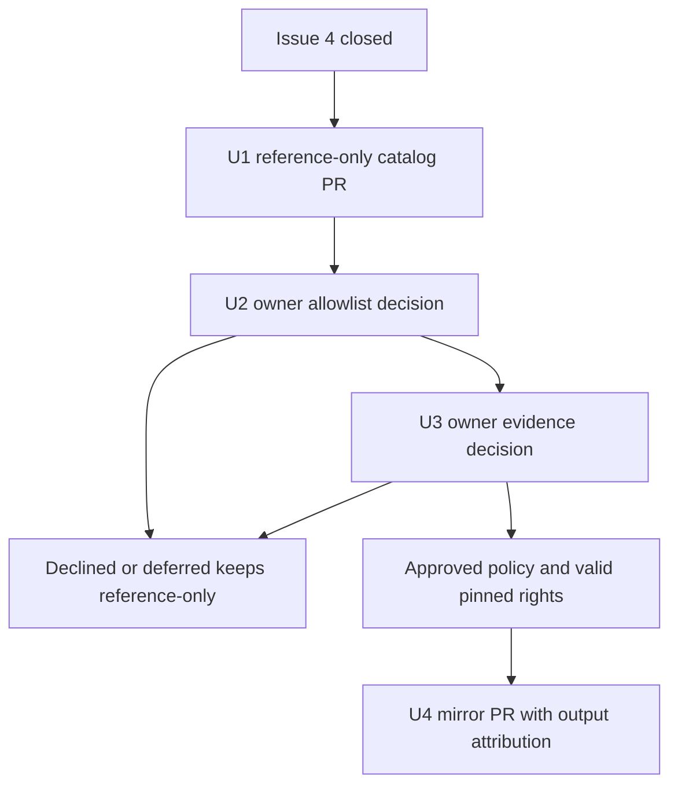
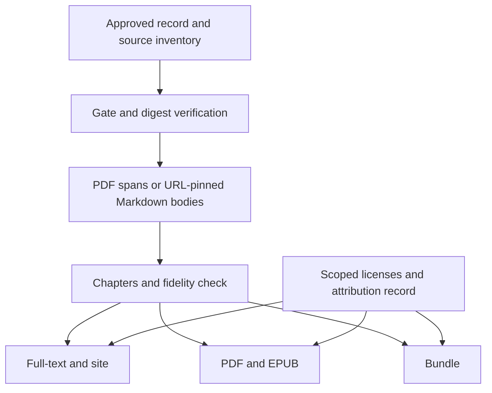

# 12-factor-agents second collection - Plan

## Goal Capsule

Readers can discover HumanLayer's 12-factor-agents in a second collection, with its mirror status and license evidence visible. A later mirror depends on the owner's policy decisions.

The delivery follows issue #5's three steps. Step 1 is specified for implementation. Step 2 is a decision brief. Step 3 is a conditional outline that needs a focused implementation pass after the decisions land.

Issue #5 and the current user request govern scope. The repository's license gate governs eligibility. Only the owner merges changes. Implementation begins after #4 closes, following #3. Planning and publishing this document may proceed now. At planning time, both predecessors are open.

Delivery has a catalog PR, one PR for each owner policy decision, and a conditional mirror PR. The catalog PR can finish independently of the policy decisions. This planning delivery ends with a pushed plan branch and an updated issue. Implementation authorization is a later action.

[Issue #5](https://github.com/LinnJS/fieldnotes/issues/5) · [Predecessor #3](https://github.com/LinnJS/fieldnotes/issues/3) · [Predecessor #4](https://github.com/LinnJS/fieldnotes/issues/4)

---

## Product Contract

### Summary

Add `12-factor-agents` as a reference-only guide in a new `humanlayer` collection. Preserve the captured distinction between content licensing and code licensing. Give the owner enough evidence to choose whether a mirror should become possible.

### Problem Frame

The catalog has one collection and accepts only `type: book`. HumanLayer publishes this guide as multiple Markdown files. Its README assigns CC BY-SA 4.0 to content and images, while its root LICENSE contains Apache 2.0. The catalog allowlist contains MIT, the evidence rule requires a license file for the work, and the ingestion reader accepts PDFs.

The initial library plan deferred share-alike until generated outputs could carry per-work licensing. Its R3, R5–R8 and license-related open questions remain the baseline, with owner-approved changes needed for the two policy choices below. [Initial library plan](2026-11-20-1731-feat-ai-resource-library-plan.html)

### Requirements

**Catalog**

- R1. Add a reference-only record for `12-factor-agents` in a second declared collection, with official links and pinned license evidence.
- R2. Choose the resource type from the work's form and preserve compatibility for existing book records.
- R3. Step 1 contains catalog facts and the license statement. Source files, chapters and source excerpts enter only through an approved mirror.

**Policy and rights**

- R4. Present the allowlist and evidence decisions separately, with consequences for every option. Each adopted policy change has its own owner-merged PR.
- R5. Eligibility follows the central gate, including matching evidence/source commits, allowed redistribution and adaptation, and the third-party-rights check.
- R6. Every conditional mirror output carries the work's attribution, license, source and modification information alongside its text.

**Conditional ingestion and order**

- R7. A Markdown reader verifies pinned inputs and fidelity alongside the existing PDF reader.
- R8. Implementation waits for #4 to close. Issue #6's books, non-commercial-license decision, author correspondence and HTML reader stay in that later milestone.

### Acceptance Examples

- AE1. After Step 1, resolve returns `type: guide`, collection `humanlayer`, `mirror_status: reference-only` and `quote_permitted: false`. Full-text and export commands exclude its text. Covers R1–R3.
- AE2. Adding CC BY-SA to the allowlist alone still leaves README-only evidence blocked. A qualifying license file alone still leaves an unallowlisted license blocked. Covers R4–R5.
- AE3. A packaged CC guide includes its creator-specific attribution and license. An adjacent MIT work retains its own license association. Covers R6.
- AE4. A Markdown body, code fence, link destination or image reference that differs from the pinned source after KTD5's declared URL transformation causes the Markdown fidelity check to fail. Existing PDF fidelity behavior remains covered. Covers R7.

### Scope Boundaries

Step 1 extends the existing catalog workflow for a collection and a guide type. Step 2 records options for owner approval. Step 3 covers only the pinned English guide and its required assets.

General repository mirroring, executable upstream tooling, translations and upstream workshops/packages are outside this milestone. A new top-level resource directory or renamed `--book` CLI would add migration work without enabling this collection, so retain the current storage and command paths. Revisit those names only when a separate consumer needs a changed interface.

### Open Questions

The two owner decisions in Step 2 block Step 3. They do not block Step 1. The mirror's exact metadata representation and test implementation need a focused planning pass after those decisions and after #4's changes are available.

---

## Planning Contract

### Pinned evidence

The capture was run with `uv run python scripts/evidence.py humanlayer/12-factor-agents --ref d20c728368bf9c189d6d7aab704744decb6ec0cc`. The default branch is `main`. The head and evidence commit both equal that full SHA. The full capture is retained outside the repository for this planning run. The following identifiers and statement are sufficient to reproduce it from the pin.

| Evidence | Captured value |
| --- | --- |
| Evidence commit | `d20c728368bf9c189d6d7aab704744decb6ec0cc` |
| Root README blob | `bf87693afef770e5da83ab3109b90f734f60b6e6` |
| Root LICENSE blob | `ded0e70b9dfb2341500a407de2eb9040cc21615c` |
| Content statement location | `README.md`, line 256 |
| Code statement location | `README.md`, line 258 |
| Root LICENSE finding | Apache License, Version 2.0 |

The captured content statement is copied verbatim below.

```text
All content and images are licensed under a <a href="https://creativecommons.org/licenses/by-sa/4.0/">CC BY-SA 4.0 License</a>
```

The captured code statement is copied verbatim below.

```text
Code is licensed under the <a href="https://www.apache.org/licenses/LICENSE-2.0">Apache 2.0 License</a>
```

The content record's evidence is `readme-statement` with proposed SPDX `CC-BY-SA-4.0`. The owner confirms that assignment by reading the linked legal text. The root Apache file records the code terms and cannot establish a content-license file. A locally saved CC legal code also cannot establish that upstream supplied such a file. [Pinned content statement](https://github.com/humanlayer/12-factor-agents/blob/d20c728368bf9c189d6d7aab704744decb6ec0cc/README.md?plain=1#L256) · [Pinned code statement](https://github.com/humanlayer/12-factor-agents/blob/d20c728368bf9c189d6d7aab704744decb6ec0cc/README.md?plain=1#L258) · [Pinned root LICENSE](https://github.com/humanlayer/12-factor-agents/blob/d20c728368bf9c189d6d7aab704744decb6ec0cc/LICENSE)

### Key Technical Decisions

- KTD1. Use `type: guide`. The work is a sectioned Markdown guide, and resource type is descriptive in the current loader and indexes. Add `guide` to the schema enum and `ResourceType`, preserving `book`. This is an additive catalog change under R2.
- KTD2. Use collection id `humanlayer` and title `HumanLayer`. The existing collection schema already accepts this declaration. Keep the resource id `12-factor-agents`, following the upstream-name rule in `add-resource`.
- KTD3. Use the zero-padded `content/factor-01-...md` through `factor-09-...md`, followed by `factor-10-...md` through `factor-12-...md`. At the pin, all nine unpadded 1–9 files are one-line redirects to their padded counterparts. The README reading order selects the padded files. Include the history file and appendix in that reading order for a later 14-section mirror. Use an explicit ordered file list rather than a glob. [Pinned reading order](https://github.com/humanlayer/12-factor-agents/blob/d20c728368bf9c189d6d7aab704744decb6ec0cc/README.md?plain=1#L197-L213) · [Pinned content directory](https://github.com/humanlayer/12-factor-agents/tree/d20c728368bf9c189d6d7aab704744decb6ec0cc/content)
- KTD4. Step 1 follows the strict permission-recording rule in `add-resource`. The short statement names a license without spelling out the grants, so record redistribution, adaptation and commercial use as `unclear`. Set attribution and share-alike flags to true to retain the named license conditions. Record this limitation in notices. Step 2's evidence decision must specify how the full incorporated terms support permission fields before a mirror can pass R5.
- KTD5. Preserve original source bytes in the committed source copy. Chapter bodies may differ only by a declared, deterministic rewrite of resource and link destinations to the pinned commit or verified local assets. Preserve every other byte, including prose and code. Fidelity compares the body with that transformation of the pinned source range, then verifies the rewrite map against the inventory. Store the map and change notice with attribution so raw and bundled chapters also use fixed targets. Every local target must exist in each package that includes its chapter, otherwise use the verified commit URL. Keep the PDF reader's existing comparison rules.

### Delivery and source flow





### Existing behavior and impact

`scripts/kb/gate.py::evaluate` checks third-party rights, missing evidence, missing SPDX, allowlist membership, evidence kind, pin existence/commit equality, then redistribution and adaptation. It returns the first refusal. When the record has no flagged third-party-rights issue, Step 1 is expected to report the allowlist refusal first. A flagged rights issue takes precedence. Commercial-use permission is recorded but does not affect this gate.

`scripts/kb/ingest.py` verifies one committed source digest, extracts PDF spans and writes drafts. `write_chapters` preserves existing chapters and reports differences. `scripts/kb/fidelity.py` compares fresh PDF sections with chapter words and link destinations, plus frontmatter. A Markdown branch must preserve those entry-point behaviors and refusal ordering.

`scripts/kb/indexes.py` already emits license-bearing per-work full-text segments. `scripts/kb/export.py` already supplies author/source/license notices to PDF and EPUB. Its bundle explicitly selects chapters and LICENSE and excludes source files. New attribution files need explicit bundle inclusion. Generic CC legal code alone lacks the creator-specific information that export metadata currently extracts from LICENSE. `scripts/kb/site.py` also needs wording that distinguishes upstream evidence from a local standard-license copy.

License acceptance also depends on `scripts/kb/checks.py`, beyond the pure gate. `_evidence_file_problem` accepts only root `license`, `license.md`, `license.txt` or `copying` names, case-insensitively. The broader scanner in `scripts/kb/evidence.py` can capture other filenames without making them accepted evidence. For mirrored records, `_check_license_file` currently requires the local LICENSE Git blob id to equal `license.blob_sha`.

The static dependency graph finds CLI callers but omits some `kb` imports. The affected consumers were also traced through catalog, frontmatter, fidelity, indexes, readpath, site and export code. Recheck those consumers against #4's final branch before implementation.

---

## Step 2 decision brief

### D1. Allow CC-BY-SA-4.0 for mirrored content

The owner chooses between retaining MIT-only policy and admitting CC-BY-SA-4.0. Approval is a separate policy PR under U2. As part of that license-scope decision, the owner must resolve whether the content grant covers code examples embedded in the selected 14 files. A code fence alone establishes no license assignment. The root code grant cannot be silently treated as CC BY-SA. If any selected material requires an unallowlisted license, or its scope remains unresolved, the whole mirror waits. Admitting Apache-2.0 or supporting a mixed-license gate would require separately approved follow-up work outside this milestone.

- **Retain MIT only.** Step 1 remains a useful reference-only catalog entry. The mirror stops here. The evidence decision may still be recorded, but it cannot make this license eligible.
- **Add CC-BY-SA-4.0.** The library accepts attribution and share-alike obligations and the output work specified below. This removes only the allowlist barrier. Evidence, permissions, matching source pin and third-party checks still apply. It does not admit `CC-BY-NC-SA-4.0`, which remains an issue #6 decision.

The legal requirements below come from the CC BY-SA 4.0 legal code read for this plan.

Section 2(a)(1) grants reproduction, sharing and adaptation. Section 2(a)(4) permits necessary format changes without making those changes alone Adapted Material. Section 3(a) requires retaining supplied creator, copyright, license, disclaimer and source information. Sharing requires a license text or link and modification indications. Attribution may suit the medium. Section 3(a)(3) requires removing the specified attribution information on the licensor's request, where reasonably practicable. Section 3(b) requires a same-elements, later-version or BY-SA-compatible adapter license when sharing Adapted Material, with its text or link. Sections 2(a)(5) and 3(b) prohibit restrictions on licensed rights. Section 2(a)(6) grants no endorsement. Section 4 separately addresses database rights. [CC BY-SA 4.0 legal code, sections 1–4](https://creativecommons.org/licenses/by-sa/4.0/legalcode.en)

The packaging design below keeps work boundaries explicit. Whether a particular combined output is Adapted Material requires applying the legal definition to that output. The plan does not assume that concatenation licenses all adjacent works under CC BY-SA. Any adaptation contributed by the library will use CC BY-SA 4.0. The owner reviews this distribution approach in U2 before approving the license.

### D2. Meet the evidence rule for content

The owner chooses a route separately from D1. Approval is its own policy PR under U3. Until that PR is merged, the current license-file rule governs.

- **Require an upstream content-license file.** Keep the existing gate and evidence-location rules. Recommend root `LICENSE.md` with CC BY-SA terms expressly scoped to content and images, alongside the existing Apache `LICENSE`. Root `LICENSE.txt` or `COPYING` would also satisfy the filename rule. A nested `content/LICENSE` or root `LICENSE-CONTENT` would be captured but rejected by current validation. Any external request must name an accepted root filename. The owner can ask HumanLayer for this file. Sending that request needs the owner's separate authorization. If upstream supplies it, capture evidence at the new commit and pin sources to that same commit. Recheck file selection and license scope. The policy PR records retaining the rule, the scoped license finding and how the supplied full grant supports the permission fields. Timing depends on upstream. When sync examines both root licenses, it will report the Apache file as an additional license. Record that known scope distinction for owner review, while continuing to review actual changes to either file.
- **Accept qualified README evidence.** The owner may approve a general, testable rule for an explicit content/image grant linked to the canonical URL of its named license and version, pinned README blob/permalink, recorded scope and matching source commit. For Creative Commons, accept either the canonical deed URL or legal-code URL and require the library to read and retain the official legal code. The pinned HumanLayer statement uses the deed URL. Its policy PR must define those fields and their validation, distinguish content from repository code, and permit permission assignments from the incorporated full terms. Missing scope, informal wording, an absent link, conflicting terms or an unverified pin keep a record reference-only. The record keeps `evidence: readme-statement`. This route also changes `scripts/kb/checks.py::_check_license_file`. Today it compares local LICENSE bytes with `license.blob_sha`, which would be the README blob. The policy PR must define a separately hashed standard legal-code record and make validation check that digest while retaining the README blob as grant evidence. Copying the README into LICENSE would defeat the source-copy restriction. Include the schema/loader representation, `tests/test_checks.py`, gate tests and workflow documentation in that owner-reviewed policy PR.
- **Defer the decision.** Retain the current evidence rule and the reference-only record. Step 3 waits.

Prefer requesting an upstream file because it preserves the current rule. That preference is a planning recommendation for the owner. The alternative remains available in the brief.

The README option applies to records that meet its conditions, rather than exempting this resource by id. Its impact report must list every existing record that meets the link condition and show gate results for all existing records. It can remove an evidence barrier for other explicit README grants, but their independent allowlist and permission barriers still apply. The four CC BY-NC-SA books remain outside the allowlist. Updating their evidence or status belongs to #6.

### License and attribution in every text output

If D1 is approved, use one work-level attribution record that all renderers consume. Store it beside `books/12-factor-agents/LICENSE`. It identifies the work and creator credit supplied upstream, HumanLayer's role, upstream repository and pinned source links, retained copyright/disclaimer notices, CC BY-SA URI, evidence link and technical changes. Verify named creator credits from the pinned source during ingestion. Record the owner's D1 scope finding for embedded code. Inspect selected sections and assets for third-party rights. The central work-level flag governs the entire mirror. A flagged or unresolved rights issue blocks it, and omitting an asset or rewriting its URL cannot clear that finding. Reconsider the evidence only when rights are actually resolved.

- **Chapter and raw source files.** Chapter frontmatter identifies the work's license, attribution-record path and source path/revision/line range. The source-file inventory associates each unchanged source and asset with its scoped license and attribution record. Retain supplied notices in the files.
- **`dist/llms-full.txt` and standalone full-text files.** Extend the existing per-work segment with full attribution, legal text, source and change notices and explicit start/end boundaries. The combined file identifies the license applying to each segment. Each chapter retains a work/attribution association if extracted from that segment.
- **PDF and EPUB.** Feed the same attribution into `checked_document`, the visible notice section and rights/creator metadata. Package full legal text and creator-specific notices inside each exported work. Include code examples only under the owner-confirmed scope in D1. Verify the files after rendering.
- **Bundle.** Extend `bundle_files` to include each mirrored work's attribution record and required licenses alongside chapters and metadata. Add their digests to MANIFEST.json. The bundle's license inventory maps paths to their terms. Bundled chapters remain attributable when opened individually. Preserve the existing exclusion of raw sources unless a later requirement changes it.
- **Topic pages.** Every quoted excerpt carries its work attribution and license notice beside the citation, including in raw topic Markdown, the staged site and the bundle. U2 amends the `topics/` row in `LICENSES.md` so excerpts retain their source license. Original editorial prose keeps its own license.
- **Site.** Render the same notices on work/chapter/license pages. Label the pinned README grant and the standard CC legal code separately when that evidence route is chosen.

A missing license or required attribution prevents generation of that work's text. Record a licensor-requested removal under Section 3(a)(3) as an approved omission, distinguish it from missing required information and retain the license notice required by Section 3(a)(1)(C). This extends the existing missing-LICENSE failure behavior. The owner-approved D1 policy documents these obligations, while U4 implements and verifies them before a CC mirror becomes reachable.

---

## Implementation Units

### PR1. Catalog the reference-only guide

Waits on #4 closing before work starts. This PR is independent of D1 and D2, as issue #5 requires.

### U1. Add the guide record and second collection

**Goal.** Deliver AE1 through the existing catalog, resolve and generated-index paths. Covers R1–R3 and R8. Follow KTD1–KTD4.

**Files.** `books/12-factor-agents/metadata.yaml`, `catalog.yaml`, `schemas/resource.schema.json`, `scripts/kb/catalog.py`, `.agents/skills/add-resource/SKILL.md`, `LICENSES.md`, `tests/test_catalog.py`, `tests/test_catalog_data.py`, `tests/test_indexes.py`, `tests/test_site_staging.py`, `tests/test_gate.py`, `README.md`, `scripts/kb/indexes.py` and `scripts/kb/site.py`. Rebuild `index/catalog.json`, `index/chapters.jsonl`, `index/topics.json` and `llms.txt` with the builder. Adjust `scripts/kb/readpath.py` only where the record's displayed type needs to say guide.

**Approach.**

1. Confirm #4 is closed and refresh local research against its merged changes. Check the catalog for the id and official URL before adding another record.
2. Expand the resource `type` enum to `book` and `guide`, and add `ResourceType.GUIDE`. Keep collection validation and existing book loading. Rename the unsupported-type test to reflect that it still rejects `article`.
3. Add the `humanlayer` collection and append the resource id in `catalog.yaml`. Narrowly amend add-resource's catalog-edit instruction to allow a required collection declaration. Its prohibition on changing `license_allowlist` remains in force.
4. Populate the metadata using the field decisions below. Capture again at the same pin if the original capture is unavailable. Copy license statement, blob ids, paths and permalinks from that output.
5. Add HumanLayer attribution to `LICENSES.md` for catalog context, distinguishing the reference record from a mirrored work. Update catalog-wide counts and terminology in `README.md` against #4's merged records. Update `tests/test_catalog_data.py`'s expected ordered ids, total/unique counts and evidence-bearing-record count. Its current values are 19, 19 and 12. After adding this one record they become 20, 20 and 13 unless predecessor work changes that baseline. Its module docstring and the test name `test_catalog_lists_the_19_books_once_each_in_order` also count books. Rename both to count resources without a fixed number.
6. Use type-neutral resource counts and headings in the site and `llms.txt`. Show the declared collection title on the guide's catalog card and machine-readable map entry. Reuse the existing status groups and card layout. Rebuild generated files through `scripts/build.py` and run validation. Report the gate result in the catalog PR for the owner.
7. Explain in the record's notices and catalog PR that sync may label the already-recorded root Apache code license as an added license when it next examines the tree. This is a known limitation of the current single-evidence comparison. Review future byte/scope changes without treating that pre-existing file as newly granted content rights.

**Record fields.**

| Field | Step 1 value or rule |
| --- | --- |
| `id`, `type`, `collection` | `12-factor-agents`, `guide`, `humanlayer` |
| `title` | Upstream's official work title, without translating it or adding a subtitle |
| `author` | HumanLayer attribution, with named creator credit verified from the pinned README retained in notices |
| `translator` | `null` unless upstream names one for this English source |
| `languages` | `en` for the selected source |
| `official_urls.repository` | `https://github.com/humanlayer/12-factor-agents` |
| Other official URLs | Only verified work-specific URLs, otherwise `null` or an empty hosted-edition list |
| `site_slug` | `null` unless the verified official site requires one |
| `upstream` | Git repository `humanlayer/12-factor-agents`, default branch `main`, captured full head commit |
| `editions` | Empty list for this unversioned multi-file source. Explain the commit snapshot in notices. A directory has no file blob id |
| `edition_patterns`, `newest_editions` | Empty maps. Avoid inventing a release version or PDF filename pattern |
| `license` | Proposed `CC-BY-SA-4.0`, `readme-statement`, exact content statement, pinned README permalink/blob/commit, actual verification date, `departs_from_template: false` for the standard license named by the statement |
| `license.locations_checked` | Pinned root README and LICENSE with their captured blob ids, plus all other license-bearing locations the evidence capture examined. Explain the content/code scope difference |
| `permissions` | KTD4's three `unclear` grants, attribution/share-alike true. Review third-party scope and set its flag from findings, with a notice for unresolved rights |
| `mirror_status` | `reference-only` |
| `pinned_source`, `extraction_profile` | Omitted in Step 1 |
| `notices` | Unversioned Markdown source, content/code distinction, permission-recording limitation, known sync alert and independent-library attribution |

No upstream prose besides the license statement belongs in that record or its fixtures. Use invented fixture prose for type/index tests.

**Test scenarios.**

- `tests/test_catalog.py` loads both a legacy book and a guide, preserving their types and declared collections. Unknown `article` and an undeclared collection fail. This tests schema/loader compatibility, while artifact output is covered below.
- `tests/test_indexes.py` builds a two-collection catalog and resolves the guide with the fields in AE1. The guide contributes no chapter rows or full-text segment. This tests generated records and exclusion, while rendered PDF/EPUB inspection belongs to U4.
- `tests/test_catalog_data.py` accepts the new ordered catalog and evidence count, retains the MIT-only policy assertion in U1, and still rejects statuses above the gate. This checks the real catalog beyond invented schema fixtures.
- `tests/test_site_staging.py` and `tests/test_indexes.py` show a reference-only guide with the HumanLayer collection and resource counts/headings. The catalog card and map entry contain official links and no source text.
- `tests/test_gate.py` keeps the MIT-only refusal and README-only refusal as independent checks. This tests policy preservation, while the new real record is checked by validation and resolve.
- Ingestion of the reference-only id refuses before reading a source or creating drafts. Full-text, site and export builds show only its catalog facts and official link. Retain existing non-mirrored exclusion coverage in `tests/test_ingest.py` and `tests/test_export.py` when these paths need changed assertions.

**Verification.** The new record resolves as AE1 specifies. Validation has no findings, generated files are current, and the catalog PR diff contains no upstream chapters, raw sources or policy changes.

### PR2. Record the owner's allowlist decision

Waits on U1 merging and the owner's D1 choice before a policy diff is prepared. The user requires this policy change to have its own PR.

### U2. Resolve D1

The owner reviews the D1 alternatives and output obligations. If approved, a PR changes `catalog.yaml`'s allowlist and documents the licensing boundary in `LICENSES.md` and `MAINTAINING.md`. Retain gate tests for an allowlisted CC license blocked by README evidence and for CC BY-NC-SA still blocked by the allowlist in `tests/test_gate.py`. Update the explicit allowlist expectation in `tests/test_catalog_data.py` to the owner-approved list, while retaining the expected gate-allowed resource set until evidence and permissions actually change. Keep the record reference-only. If declined, record the decision and finish with the catalog entry. Covers R4–R6. This unit is a decision brief, pending owner direction.

### PR3. Record the owner's evidence decision

Waits on the owner's D2 choice and U2's decision record. Its separate PR isolates the second policy question as requested.

### U3. Resolve D2

Apply the chosen D2 route to its own policy PR. The upstream-file route preserves `gate.py` and the evidence-location rule when the file uses D2's accepted root filename. Record the scoped evidence, recaptured source pin and known additional-code-license sync finding. The README route needs a precise gate/schema contract, separate grant-evidence and distributed-license digests, permission-provenance rules and regression tests in `tests/test_gate.py`, `tests/test_checks.py`, `tests/test_catalog.py` and `tests/test_catalog_data.py` before coding it. For the upstream-file route, cover an accepted root content-license file beside Apache LICENSE under the retained license-file rule, and rejection of nested or unaccepted evidence names. For the README route, cover README evidence with a correctly hashed standard legal code plus a changed-code-digest failure. Include the repository-wide decision impact report in either route. Retain the record's reference-only status until U4 is ready. Covers R4–R5. Exact implementation awaits the owner's selection.

### PR4. Conditional Markdown mirror

Waits on #4 closing and U1–U3 merging with decisions that permit the mirror. Its implementation uses the approved policy and follows the source-copy restriction in R3.

### U4. Add the reader, rights packaging and pinned mirror

This is an outline under R5–R7. Expand it after policy approval, then implement it as one mirror PR so no new text becomes distributable before attribution works.

- Extend `schemas/resource.schema.json` and `scripts/kb/catalog.py` with a discriminated Markdown source form containing repository, commit, language, commit-derived edition label and an ordered per-file inventory. Each entry has upstream path, Git blob SHA, SHA-256 and committed local path. Treat absent format on existing source records as PDF. Preserve their schema acceptance and loader behavior.
- Add a Markdown extraction profile with explicit file order and stable chapter slugs. Preserve the PDF profile. Commit the selected 14 source files and referenced required assets with their digests only when the mirror is approved. A commit-derived label identifies a snapshot and must be described as library-assigned.
- Extend `scripts/kb/checks.py::_check_mirrored_book_files` to accept every file in the Markdown source inventory and the attribution record. Today it accepts only `metadata.yaml`, `LICENSE`, one `pinned_source.local_path` and `chapters/*.md`, so each new file would be reported as `book-unexpected-file`. Keep that finding for any file the record does not list. Add both cases to `tests/test_checks.py`.
- Add `scripts/kb/markdown_source.py` beside `scripts/kb/pdf_spans.py`. Dispatch from `scripts/kb/ingest.py` by source format after the central gate. Reuse draft/write reporting and existing no-overwrite behavior. Copy each selected file into one chapter using only KTD5's declared URL transformations, with library frontmatter prepended.
- Extend `schemas/chapter.schema.json` and `scripts/kb/frontmatter.py` for Markdown source paths and real line ranges, with `pages: null`. Preserve the existing PDF page object. Update provenance consumers in `scripts/kb/readpath.py`, `scripts/kb/indexes.py`, `scripts/kb/site.py`, `scripts/kb/export.py` and related templates. Markdown citations use source file/lines, without invented page numbers. Keep the standard-library-only Python 3.9 read path usable in a fresh clone.
- Extend `scripts/kb/fidelity.py` to verify every source digest and compare each stored chapter body byte-for-byte with the deterministic KTD5 transformation of its listed source range after removing only library frontmatter. Check that every rewrite targets the approved inventory and that all bytes outside destination spans are unchanged. Compare expected source path/revision/lines, order and slug mapping as well. Detect missing, extra and duplicated sections. Keep PDF comparison and accepted-difference behavior confined to PDF input.
- Implement the attribution/output contract above. Read the selected sources to inventory mixed code/content notices and asset rights. Use KTD5's tested mapping for chapter links/images and any output-specific local paths. A required asset that lacks verified rights or a fixed source blocks the mirror under R5. Apply the whole-work flag rather than treating per-asset omission as a gate exception. A fidelity pass proves body copying, while rendered export inspection proves usable links, code blocks, images and notices.
- Update `.agents/skills/ingest-book/SKILL.md`, add-resource source guidance and `AGENTS.md` where they assume every source has PDF pages. Extend `scripts/kb/sync.py` only as needed to report changes to the pinned Markdown inventory under its existing commit-change reporting.
- Set the approved record to mirrored in this PR, then regenerate indexes and add topic references only for sections actually read. Leave chapters `machine-extracted`. Human review is a separate action by a person.

The test seams are `tests/test_catalog.py`, `tests/test_checks.py`, `tests/test_frontmatter.py`, `tests/test_ingest.py`, `tests/test_fidelity.py`, `tests/test_indexes.py`, `tests/test_export.py`, `tests/test_site_staging.py` and `tests/test_resolve.py`, plus proposed `tests/test_markdown_source.py`. Add invented fixtures for copy/order/redirect exclusion, permitted URL pinning, unexpected text/code/link/image changes, bad hashes, mismatched pins, missing sources, repeated ingestion and old PDF records. Test full-text segment boundaries, attribution loss and requested removal, topic-excerpt notices, bundle notice inclusion and manifest digests, then inspect PDF/EPUB read-back. Extend `tests/test_topics.py` for excerpt-license association. Verify bundled and raw chapter image URLs use the fixed inventory. Run #4's eval command against both existing mirrored books and the new guide using its merged interface.

---

## Verification Contract

These are implementation checks for the named units. Planning does not run production tests or modify catalog state.

| Check | Applies to | Required result |
| --- | --- | --- |
| `uv run python scripts/validate.py` | Every implementation PR | `validate: no findings.` |
| `uv run python scripts/build.py --check` | Every implementation PR | Generated artifacts match their canonical sources |
| `uv run pytest` | Schema, policy and reader/output changes | Existing tests and the unit's new scenarios pass offline |
| `uv run ruff check .` and `uv run mypy` | Python changes | Lint and strict typing pass |
| `python3 scripts/resolve.py 12-factor-agents` | U1, U4 | AE1 after U1, approved mirrored status and truthful source provenance after U4 |
| `uv run python scripts/ingest.py --book 12-factor-agents --check` | U4 | Source inventory, chapter bytes and frontmatter match the pin |
| Full-text, site and PDF/EPUB/bundle builds | U1 exclusion, U4 inclusion | Correct status filtering and all applicable attribution/license notices travel with the text |
| Milestone #4 eval command | U4 | Both earlier works, Loop Engineering and the Hermes Agent mirror from #3, retain their expected results and guide coverage passes |

Recheck test paths and command names after #4 merges. The current repository has no eval runner, so this plan cannot name #4's future interface as an existing command.

---

## Definition of Done

Step 1 is done when the owner has a catalog PR that passes U1's checks and resolves as AE1. Step 2 is done when each owner choice and its consequences are recorded separately. A declined or deferred choice leaves the guide reference-only. Step 3 is done only if the owner-approved gate permits the pinned work and U4's fidelity, attribution, exports and eval checks pass in an owner-reviewable PR.

Implementation diffs contain only the chosen work and its necessary schema, workflow and output changes. Remove abandoned experiments. Generated files come from builders. Every commit subject and issue title uses `type(topic): description`. Only the owner merges.
