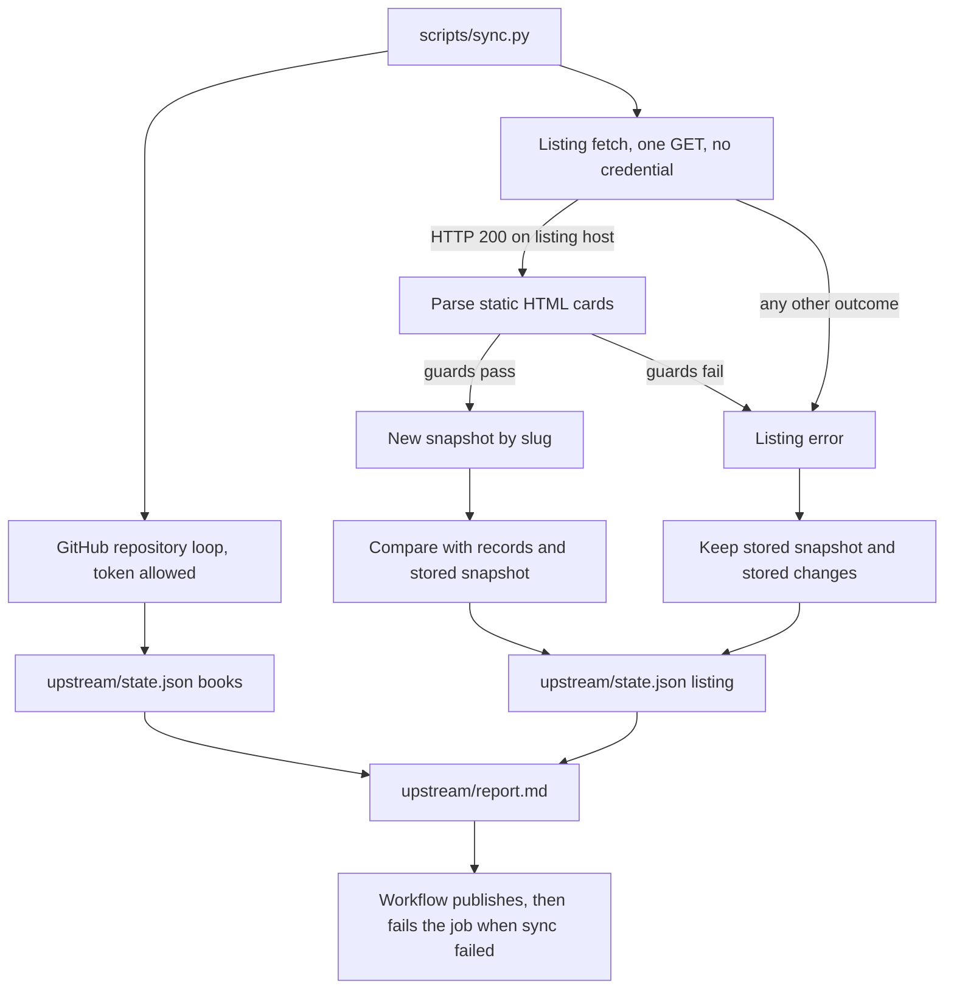

# Milestone 4 license evidence for the 17 reference-only books - Plan

---

## Goal Capsule

This plan covers milestone 4 of 4, GitHub issue LinnJS/fieldnotes#6, `feat(licensing): seek license evidence for the 17 reference-only books`.

It delivers four things that need no reply from the author.

1. A letter to HuaShu, drafted in Chinese and English, for the owner to approve and send.
2. A decision brief on adding `CC-BY-NC-SA-4.0` to the allowlist. The owner's decision stays pending.
3. A decision brief on whether to keep listing Claude Code Source Analysis. The owner's decision stays pending.
4. A check of the author's listing page, inside the existing sync command and weekly report, that reports new books and changes to listed entries.

Everything that depends on the author's reply, or on the owner widening the allowlist, sits under Deferred to Follow-Up Work with a trigger, a sequence, and tests.

**Milestone order.** Issues #3, #4, and #5 come first and are out of scope here. This milestone goes last because its evidence work waits on the author. The letter is the one exception. It can go out as soon as the owner approves it, before the other milestones finish, because sending it changes no file in the library.

**Planning boundary.** No code was written, and no test or build was run. No book text was opened or paraphrased. Issue #5 now has a published milestone 3 plan. Its evidence routes still await owner approval, so the current license-file rule stands. Re-read the final owner decision before implementation.

---

## Product Contract

### Summary

17 of the 19 cataloged books are `reference-only`, and the library holds none of their text. The gate in `scripts/kb/gate.py` refuses each one for a recorded reason. This milestone asks the author for evidence that could change those reasons, puts two policy questions in front of the owner with what each choice costs, and closes a monitoring gap. The seven site-only books and any new book on the author's listing are invisible to the weekly sync today.

### Problem Frame

The 17 records fall into three evidence groups. R / A / C is redistribution, adaptation, and commercial use as recorded.

| Resource id | Group | Repository or site slug | R / A / C | Third-party flag |
| --- | --- | --- | --- | --- |
| `codex-orange-book` | CC BY-NC-SA in README | `alchaincyf/codex-orange-book` | allowed / allowed / denied | no |
| `claude-code-orange-book` | CC BY-NC-SA in README | `alchaincyf/claude-code-orange-book` | allowed / allowed / denied | no |
| `deepseek-harness-orange-book` | CC BY-NC-SA in README | `alchaincyf/deepseek-harness-orange-book` | allowed / allowed / denied | no |
| `3d-vibe-coding-handbook` | CC BY-NC-SA in README | `alchaincyf/3d-vibe-coding-handbook` | allowed / allowed / denied | yes |
| `harness-engineering-orange-book` | Informal README terms | `alchaincyf/harness-engineering-orange-book` | unclear / unclear / unclear | no |
| `obsidian-ai-orange-book` | Informal README terms | `alchaincyf/obsidian-ai-orange-book` | allowed / unclear / unclear | no |
| `polymarket-orange-book` | Informal README terms | `alchaincyf/polymarket-orange-book` | allowed / unclear / unclear | no |
| `agent-skills-orange-book` | Informal README terms | `alchaincyf/agent-skills-orange-book` | unclear / unclear / denied | no |
| `openclaw-orange-book` | Informal README terms | `alchaincyf/openclaw-orange-book` | unclear / unclear / unclear | no |
| `claude-code-source-analysis-orange-book` | Informal README terms | `alchaincyf/claude-code-source-analysis-orange-book` | unclear / unclear / unclear | yes |
| `cursor-orange-book` | Site only | `cursor` | unclear / unclear / unclear | no |
| `gemma4-orange-book` | Site only | `gemma4` | unclear / unclear / unclear | no |
| `opus-4-7-system-card-orange-book` | Site only | `opus-4.7` | unclear / unclear / unclear | yes |
| `founders-playbook-orange-book` | Site only | `founders-playbook` | unclear / unclear / denied | yes |
| `doubao-work-orange-book` | Site only | `doubao-work` | unclear / unclear / unclear | no |
| `amazon-quick-orange-book` | Site only | `amazon-quick` | unclear / unclear / unclear | no |
| `phone-skill-orange-book` | Site only | `phone-skill` | unclear / unclear / unclear | no |

Exceptions that change a decision.

- **The flag outranks any license.** Four records set `third_party_rights`. The gate refuses them at its first condition, before it reads the license. A license file from the author alone cannot clear the blocker on 3D Vibe Coding, Source Analysis, the Opus 4.7 System Card edition, or Founder's Playbook.
- **Three of the four CC BY-NC-SA books have no recorded third-party blocker.** Codex, Claude Code, and DeepSeek Harness have no flag. 3D Vibe Coding names Three.js under MIT and OpenStreetMap data under ODbL in its README.
- **Six site-only books show no terms, and one shows a limited-use notice.** The issue says seven have no terms found. The Founder's Playbook page carries a notice that limits the translation to personal study and internal research with no commercial distribution. The record holds it as a notice with evidence `none`, because a web page has no commit to pin.
- **Founder's Playbook is Anthropic's work.** The record names Anthropic as author and HuaShu as translator. The Opus 4.7 System Card edition is a translation of Anthropic's document with HuaShu's commentary.
- **Two informal records already allow redistribution.** Obsidian AI and Polymarket record redistribution as allowed with attribution. Adaptation stays unclear, and neither names an SPDX license.
- **Two site-only reading links are mutable.** Phone Skill and Founder's Playbook point at a location named `latest`.
- **Branches differ.** `obsidian-ai-orange-book` and `3d-vibe-coding-handbook` use `master`. The other eight repositories use `main`.

Two code facts shape the rest of the plan.

- `kb.gate.evaluate` reads `third_party_rights`, the evidence kind, the SPDX id, the allowlist, the pinned source, the commit match, and the redistribution and adaptation permissions. It never reads `commercial_use`, `share_alike`, or `attribution_required`.
- `kb.sync.check_books` gives every URL-source book the classification `not-checked` with no state entry. The state file is `{"books": ...}` keyed by resource id with a `head_commit`, so a site observation has no honest place in it today.

### Requirements

**Author outreach**

- R1. The plan holds one letter, ready for the owner to approve and send. Nobody but the owner sends it.
- R2. The letter asks for a root license file in each of the four repositories whose README states CC BY-NC-SA 4.0.
- R3. The letter asks which terms cover the six repositories with informal terms and the seven site-only books. It names each repository by URL and gives all seven site links.
- R4. The letter says the library is independent and that the author has not endorsed it. It describes the intended use in full, which is a faithful Markdown mirror with attribution and source pins, published in the repository, the site, the full-text file, a PDF and EPUB per book, and the ZIP bundle.
- R5. The letter asks whether a grant covers every edition, every translation, and the images. It asks for no rights in third-party material and implies no permission for it.
- R6. The plan records the language choice and its assumption.

**Policy decisions**

- R7. The plan gives the owner a decision brief on `CC-BY-NC-SA-4.0` with options and a recommendation, and leaves the decision pending. Legal statements carry a link to the official text and stay apart from project inferences.
- R8. The brief names the files and outputs that admission would touch, and separates the license boundaries that exist from the NonCommercial and ShareAlike handling that is missing.
- R9. The plan gives the owner a decision brief on listing Claude Code Source Analysis, with the real removal seam.
- R10. Whatever the owner decides is recorded in `MAINTAINING.md` in a pull request the owner merges.

**Listing observation**

- R11. One command checks the author's listing page for new books and for changes to listed entries. It is the existing `scripts/sync.py`, and its findings go into the existing weekly report.
- R12. The check tracks, per canonical slug, the title, the detail URL, the reading link, the PDF access link, the repository link, the displayed version, and the displayed page count. It ignores star counts, order, covers, and styling.
- R13. The check requests the listing page only. It never requests a detail page, a reading page, a receive page, or an edition file, and it never parses script content.
- R14. Known entries are matched through `site_slug` in the catalog. An unknown slug is reported and never becomes a resource id or a catalog change.
- R15. A fetch or parse failure keeps the last successful listing snapshot, reports an error, and reports no absence. A valid page that omits a cataloged slug reports that one absence.
- R16. State is deterministic. An older `{"books": ...}` state file loads as a state with no listing snapshot. Two runs over the same inputs write the same bytes. `--dry-run` writes nothing.
- R17. A listing request carries no GitHub credential. GitHub failures and listing failures do not affect each other's results.
- R18. A listing finding is a lead for a person. It never appears as a `LICENSE-FINDING` line and never earns the `license-change` label.

**Sync integration**

- R19. A listing failure is visible on standard error and in the report, and it makes the command exit nonzero. The weekly workflow still publishes the state and report it produced, then fails the job.
- R20. The existing rule for repositories is preserved. The command still exits nonzero when every checked repository ended in error.

**Boundaries**

- R21. No active unit changes `catalog.yaml`'s allowlist, a `mirror_status`, license evidence, or the gate.
- R22. A page on the author's site or an email reply is a lead or a catalog notice. It is never recorded as license evidence under the current schema.
- R23. The HTML source reader stays deferred unless the owner widens the allowlist.

---

## Planning Contract

### Key Technical Decisions

- KTD1. **The letter is bilingual, Chinese first.** The author publishes in Chinese. The English text lets the owner review the request. This language choice is a planning assumption. The Chinese draft has had no native-speaker review.

- KTD2. **The letter asks for evidence in the form the schema can hold.** `schemas/resource.schema.json` allows the evidence kinds `license-file`, `readme-statement`, and `none`, and anything other than `none` needs a statement, a blob id, a commit, and a permalink with a full commit SHA. `kb.checks` restricts the permalink to a GitHub blob URL at the recorded commit. The letter therefore asks for a root license file, and for the site-only books it asks for a source edition and scoped root license together in the same public GitHub repository and commit. A terms-only repository would still leave the source unpinnable under the current rule.

- KTD3. **The allowlist does not change in this milestone.** The NC-SA brief recommends recording a decision and leaving `license_allowlist` as it is until evidence exists and the compliance work has landed. Building NonCommercial handling now would be speculative, since no book can use it.

- KTD4. **The listing check lives in the sync command, in its own module.** `scripts/kb/listing.py` holds the fetch, the parser, the snapshot, and the comparison. `scripts/kb/sync.py` holds the state and the report. The GitHub repository loop in `check_books` stays as it is. A `BookState` is never built for a URL source, so no listing observation carries a `head_commit`.

- KTD5. **Listing state is a distinct top-level key.** The state file gains a `listing` key beside `books`. A state file with no `listing` key is valid and means no snapshot yet. The key is left out until the first successful listing read.

- KTD6. **The parser reads rendered static HTML with the standard library.** The observed page puts each book's title in an `h3` that wraps a link to `/orange-books/<slug>/`. The reading link is `/orange-books/<slug>/read/`. The PDF link is `/orange-books/receive/?book=<slug>`, which is an access route and no file. The page count is split by a comment node, as in `122<!-- --> 页`. Hrefs are relative. Links repeat for the desktop and mobile layouts. The parser uses `html.parser`, skips `script`, `style`, and `template` content, and adds no dependency.

- KTD7. **A card is found by structure and never by class name.** An entry is an `h3` link whose path is `/orange-books/<slug>/` on the listing host, with the slug limited to lowercase letters, digits, dots, and hyphens, and with `receive` and `covers` excluded. The entry's card is the largest ancestor element that holds exactly one such entry, stopping below `section`, `main`, and `body`. Class names carry styling and are ignored.

- KTD8. **Duplicates merge, and conflicts are errors.** The same slug can appear more than once. Equal field values merge into one entry. Two different values for one field of one slug is a parse error.

- KTD9. **Three guards separate a real delisting from a failed read.** A snapshot is valid only when the response is HTTP 200 from the listing host, at least one well-formed entry was parsed, and every candidate card has a consistent identity and parseable tracked fields. Anything else is a listing error that keeps the previous snapshot. The check never hard-codes 19.

- KTD10. **Findings have two bases, and each base has a stated lifetime.**

| Basis | Finding | Clears when |
| --- | --- | --- |
| Catalog | A slug on the listing that no record carries | A record with that `site_slug` exists |
| Catalog | A record of the collection with a `site_slug` that the valid listing omits | The slug returns or the record changes |
| Catalog | A URL-source record whose listing entry now shows a repository link | The record names the repository |
| Catalog | A URL-source record whose displayed version differs from its newest recorded version | The record catches up |
| Snapshot | A tracked field of an entry differs from the last different snapshot | The next snapshot that differs |

Catalog findings are computed again on every run from the current snapshot and the records. Snapshot changes are stored with the snapshot. When a new snapshot equals the stored one, the stored changes are kept, which mirrors how `_observe` returns the previous state for an unchanged head. The first successful read records a baseline with no snapshot changes. Persist that baseline comparison result while the snapshot stays identical, so the first and second report have the same bytes. Catalog findings, including unknown slugs on that first read, still appear. The report says that snapshot changes describe the last observed change.

- KTD11. **Absence is scoped to the collection.** Only records in the `orange-books` collection with a non-null `site_slug` are expected on this listing. `site_slug` is nullable in the schema, so a resource from another author is never reported absent. The listing URL and the collection id are constants in `scripts/kb/listing.py`. A catalog field for a listing URL is deferred until a second listing exists.

- KTD12. **The listing request is honest and uncredentialed.** The request goes through the injected `Fetch` with a `User-Agent` that names Fieldnotes and its repository URL and an `Accept` header, and nothing else. It never passes through `GitHubClient`, so no `Authorization` header can reach the author's site. It uses the existing timeout. The site fetch must expose redirect outcomes so an off-host destination is refused before another request, and bound the response while reading it. The existing `fetch_with_urllib` follows redirects and reads an unbounded body, so it cannot supply these guarantees unchanged. Keep that adjustment local to the site fetch. `main` and `sync_library` therefore take a second injected `Fetch` for the site, which defaults to a function that does not follow redirects and caps the body it reads. On a redirect, that default returns the 3xx `Response` with its `location` header, so `kb.listing` can refuse an off-host target. Tests can pass the same recording fake to both parameters. The check uses no browser identity and works around no challenge.

- KTD13. **Error text is fixed per kind.** The report sentence for a listing error names the kind and the HTTP status and holds no time, no reset value, and no exception text. The person at the terminal gets the detail on standard error. A repeated identical failure then writes identical bytes.

- KTD14. **A listing failure exits nonzero after the files are written.** The command writes the state and the report first, as it already does when every repository fails. The exit code is 1 when the library or the state cannot be read, when every checked repository ended in error, or when the listing read failed. A corrupt state file still stops the command before it writes anything.

- KTD15. **The workflow publishes before it fails.** `.github/workflows/sync.yml` runs the command in one step, and a nonzero exit skips the diff, the validation, the push, and the pull request. The sync step records its outcome and lets the job continue. The existing steps run on whatever changed under `upstream/`. A final step fails the job when the sync step failed. When the command wrote nothing, nothing changed, so nothing is published. The change also applies when every repository ends in error. That run fails before publishing today, and it will publish its report and then fail. The plan intends this, because the kept state entries preserve earlier findings and the published report shows the errors.

- KTD16. **Site values are written as inert code spans.** Titles, slugs, URLs, versions, and page counts come from the author's page. The report writes each one with the existing `_code` helper. Every listing line starts with fixed words of the library's own, so no site value can start a line, and no listing line can match the workflow's `LICENSE-FINDING` pattern.

- KTD17. **Test fixtures are synthetic.** The real listing page is the author's, with no license found. Fixtures under `tests/fixtures/listing/` are invented pages that copy only the element shapes. `LICENSES.md` already says invented fixtures are the library's own, and it gains a line for this directory.

### Milestone 3 evidence dependency

The published milestone 3 plan offers two routes, with neither approved yet. It prefers an upstream root content-license file. Its alternative is a general qualified-README rule requiring an explicit scoped grant, a canonical deed or legal-code link, a pinned README blob and matching source commit, permission provenance, and separately hashed official legal-code bytes. The README keeps its evidence kind. A local standard-license copy cannot become upstream license-file evidence. [Milestone 3 decision brief](https://github.com/LinnJS/fieldnotes/blob/aa2295a4439e99b3c83fc5de0046116ddf354310/docs/plans/2026-11-24-1506-feat-12-factor-agents-collection-plan.md#d2-meet-the-evidence-rule-for-content).

All four NC-SA metadata records already include an HTTP link to the CC BY-NC-SA 4.0 deed. If the owner approves that general route, check each grant against its final scope and canonical-URL normalization requirements and reuse its separate grant-evidence/legal-code representation. A deed link alone does not satisfy the proposed rule. All four still need a pinned source, all need NC-SA admission and operating/output support, and 3D retains its third-party blocker. If the owner chooses the upstream-file route or defers, keep requesting root license files. The outreach requests those files under either route.

Reuse milestone 3's approved work-level attribution record, start/end boundaries, per-chapter associations, bundle inventory and requested-attribution-removal handling wherever they satisfy NC-SA. Milestone 4 adds the NC operating policy and remaining NC-specific checks. Implement no parallel attribution system.

### Listing data flow

### Decision brief on CC-BY-NC-SA-4.0

**Legal code summary.**

Sections 1 and 2(a)(1) permit reproduction, sharing, and adaptation for NonCommercial purposes. That definition concerns uses primarily intended for or directed toward commercial advantage or monetary compensation. Section 2(a)(4) permits technical format changes without creating Adapted Material. Section 3(a) requires supplied attribution, copyright, license and disclaimer notices, a practicable source link, modification indications, and the license text or URI. Section 3(b) requires shared adaptations to use the same license elements at version 4.0 or later, or a designated compatible license. Sections 2(a)(5)(C) and 3(b)(3) forbid additional restrictions and restrictive technological measures. The grant covers rights the licensor controls and supplies no endorsement. Section 4 can treat a new database incorporating substantial licensed database contents as Adapted Material where sui generis database rights apply. Section 6 provides automatic termination for noncompliance and reinstatement after cure within 30 days of discovery. [CC BY-NC-SA 4.0 legal code](https://creativecommons.org/licenses/by-nc-sa/4.0/legalcode.en).

**Collections and adaptations.**

A collection can keep separate licenses for its included works. Its own license does not replace those licenses. The included NonCommercial conditions still apply. Whether a creative modification is an adaptation depends on applicable law. Commercial purpose depends on the use, including when the user is a nonprofit. [Creative Commons FAQ](https://creativecommons.org/faq/#if-i-create-a-collection-that-includes-a-work-offered-under-a-cc-license-which-licenses-may-i-choose-for-the-collection).

**Project inferences.** The following are proposed library policies derived from those conditions.

- **Format conversion.** A chapter is meant to be a faithful copy of a pinned edition, and the library forbids rewording. Turning a PDF into Markdown reads as a format change under Section 2(a)(4). Splitting a book into section files and repairing structure sits closer to the line. Treating the library's own contributions inside those chapter files as offered under the same license would satisfy either reading.
- **Editorial text.** A topic paragraph that reports what an NC-SA chapter says is the library's wording under CC BY 4.0 today. A paraphrase could be adapted material. An approved policy has to say whether such paragraphs are allowed and under which license.
- **Collections.** The repository, the site, `dist/llms-full.txt`, and the ZIP bundle each read as a collection of separately licensed works. The MIT license on the code and the CC BY 4.0 license on the library's prose stay independent as long as each mirrored work is clearly bounded. The NonCommercial condition still follows the work into every collection that includes it. A combined file or a bundle that holds an NC work cannot be reused commercially as a whole, so the output must identify which parts carry which terms. Creating extra NC-free distributions is deferred until a user needs them.
- **NonCommercial operation.** Whether the library's own publication is NonCommercial depends on how it is run. Only the owner can state that, and the statement has to stay true.

**What exists today, and what is missing.**

| Output or check | Boundary that exists | Missing for NC and SA |
| --- | --- | --- |
| `scripts/kb/gate.py` | Refuses on the flag, evidence, SPDX id, allowlist, pin, and two permissions | Reads neither `commercial_use` nor `share_alike`, so an allowlisted NC work with a license file would pass with no NC condition checked |
| `scripts/kb/checks.py` | Ties evidence to a GitHub blob at the recorded commit | No rule that a record with this SPDX id must record commercial use denied, share-alike true, and attribution required |
| `dist/llms-full.txt` and `dist/llms-full/<id>.txt` from `scripts/kb/indexes.py` | Each book segment opens with author, edition, source pin, license id, and the full license text. The opening says the library's license does not apply to the books | No statement of the NC and SA conditions for the combined file, no statement that the copy was converted, and no explicit output-wide notice directing readers to each book's terms. Today the file also carries no unofficial or not-endorsed statement, no translator line, and no official repository or site link in its opening or in a book segment |
| PDF and EPUB from `scripts/kb/export.py` | A notice section with attribution, source permalink, the unofficial statement, notices, and the license in full | No modification statement beyond the extraction count, and no NC wording in the rights metadata beyond the id |
| ZIP bundle from `scripts/kb/export.py` | Carries `books/<id>/LICENSE`, `LICENSES.md`, and every record | No explicit mixed-license inventory identifying NC-SA components |
| Site | Built from the same gate decision through `quote_permitted` | `scripts/kb/site.py` already creates a per-book overview with attribution, a license-text link and source details. Follow-up F2 adds NC/SA and conversion notices consistently to book and chapter views |
| `LICENSES.md` | States that a mirrored work keeps its own license and that MIT does not apply to it | No NonCommercial operating statement and no row for the library's contributions inside NC-SA chapter files |
| `AGENTS.md` and the skills | Quote rules by mirror status | No guidance for quoting NC-SA text into a user's project |

**Files an admission would touch.** `catalog.yaml`, `scripts/kb/gate.py`, `scripts/kb/checks.py`, `scripts/kb/indexes.py`, `scripts/kb/export.py`, `scripts/kb/site.py`, `scripts/kb/catalog.py`, `schemas/catalog.schema.json`, `LICENSES.md`, `MAINTAINING.md`, `AGENTS.md`, the generated `index/catalog.json`, and the tests `tests/test_gate.py`, `tests/test_catalog_data.py`, `tests/test_checks.py`, `tests/test_indexes.py`, `tests/test_export.py`, `tests/test_site_staging.py`, and `tests/test_site_build.py`.

**Options.**

| Option | What it does | Cost and risk |
| --- | --- | --- |
| A. Decline | The allowlist stays as it is. The decision is recorded | The three unflagged NC-SA books stay links even if the author adds license files |
| B. Accept in principle, enable later | The owner records the conditions under which the id may join. The allowlist line changes only in the pull request that lands the gate and output work, after at least one book has a license file | The owner commits to an operating statement. The work is bounded and starts only on a trigger |
| C. Add the id now | One line in `catalog.yaml` | No current record becomes eligible merely from the allowlist edit. A qualifying README rule from issue #5 could remove the evidence-kind blocker. All four still need a pinned source, and 3D still has a third-party blocker. Once those other conditions are met, the current gate could admit NC-SA without checking NC operation |

**Recommendation.** Option B, or option A if the owner does not want to make a NonCommercial operating statement. Option C is not recommended. The decision is the owner's and is pending.

### Decision brief on listing Claude Code Source Analysis

**Facts on record.** The record's README notice says the book analyzes Claude Code source code exposed in a leak in March 2026. The record is `reference-only`, sets `third_party_rights`, and holds informal terms with no SPDX id. The library holds none of its text. Eight topic files reference it.

**What a license cannot do.** The gate refuses a flagged record at its first condition. HuaShu can license his own analysis. He cannot grant rights in source code that belongs to someone else. A new license from the author alone cannot clear the flag. Keeping the record preserves its `reference-only` status. F6 applies only if evidence later resolves the underlying third-party scope.

**Option 1. Keep the listing.** The record stays as it is, with one added notice that says the owner reviewed the listing, that the library holds no text of the book, and that a license from the author would not clear the flag. Readers and agents still learn that the book exists and where the author publishes it.

**Option 2. Remove the listing.** One reviewed change does all of the following.

- Remove the id from `catalog.yaml` and delete `books/claude-code-source-analysis-orange-book/`. Removing the id alone fails validation, because `kb.checks` reports an unlisted directory.
- Remove the frontmatter reference and the body pointer in `topics/agent-architecture.md`, `topics/agent-orchestration.md`, `topics/agent-security.md`, `topics/coding-agents.md`, `topics/context-engineering.md`, `topics/harness-engineering.md`, `topics/memory-and-state-management.md`, and `topics/tool-use-and-integration.md`.
- Update the catalog row and the counts in `README.md`, and record the decision in `MAINTAINING.md`.
- Rebuild `index/catalog.json`, `index/topics.json`, `index/chapters.jsonl`, and `llms.txt` with `scripts/build.py`. Rebuild the site and the exports so the old listing is gone.
- Adjust the inventory assertions in `tests/test_catalog_data.py`. The resource count and the count of records with evidence each drop by one from whatever the earlier milestones left.
- Review `evals/prompts.yaml`, where the id sits in a `forbidden_ids` list. Keep the negative example working without a catalog id that no longer resolves.
- Let the next sync drop the id from `upstream/state.json`. The listing check will report `source-code` as uncataloged if it remains on the author's page. The owner can recognize that lead as the work they chose to exclude. Stable repeated findings create no new output changes.

**Recommendation.** Option 1. A catalog record is a fact about a public work, the flag already blocks any mirror, and the notice makes the reason visible. The owner can choose removal, and follow-up F5 holds that work. The decision is pending.

### The letter to the author

The owner reads the notes, fills the bracketed fields, and sends the letter. Nobody else sends it.

**Notes for the owner before sending.**

- Fill `[name]` and `[contact]`. Use the contact address you want the author to use.
- Choose the channel. See owner decision OD1.
- Drop the paragraph about the weekly listing check if unit U2 is not going ahead.
- A reply is private correspondence unless the author posts it in public. `MAINTAINING.md` says private correspondence is never pasted into an issue or a commit.

**Subject.** 关于橙皮书许可文件和授权条款的请教 / A request about license files and terms for the Orange Books

**Chinese text.**

花叔你好，

我是 [name]，在维护一个叫 Fieldnotes 的开源项目（ https://github.com/LinnJS/fieldnotes ，站点 https://linnjs.github.io/fieldnotes/ ）。它是一个独立的、由社区维护的 AI 工程资料库，第一个合集收录的就是你的橙皮书系列。这个项目没有得到你的认可或背书，项目的 README、许可说明、文档站点，以及每本书的 PDF 和 EPUB 里都写明了这一点。

资料库的目录条目记录书名、官方链接和我们找到的许可声明。只有在核对许可依据、授权范围和项目政策之后，我们才会镜像一本书的正文。其他书籍只列出条目和官方链接。下面想请你确认 17 本书的许可情况。

镜像正文指的是对某一个固定版本做忠实的 Markdown 镜像。每一节一个文件，不改写、不删减、不润色原文。每份副本都标明来源仓库、提交号、文件和版本号。每本书的站点介绍页、PDF 和 EPUB 还会标明作者和译者署名，附上官方仓库和站点链接，并注明这是非官方副本。分发文件附上完整许可文本，站点页面链接到每本书的许可页面。这些内容会出现在 Git 仓库、公开的文档站点、供 AI 助手读取的全文文件、每本书的 PDF 和 EPUB，以及一个 ZIP 打包文件里。

想请你帮忙确认下面几件事。

一、README 里写明 CC BY-NC-SA 4.0 的四个仓库

目前资料库的镜像许可名单只有 MIT。我们还在请项目所有者决定是否接纳 CC BY-NC-SA 4.0，以及如何遵守非商业和相同方式共享的要求。补充许可文件能帮助我们核对授权，但不会直接让一本书进入镜像。请保留你希望采用的许可。

- https://github.com/alchaincyf/codex-orange-book
- https://github.com/alchaincyf/claude-code-orange-book
- https://github.com/alchaincyf/deepseek-harness-orange-book
- https://github.com/alchaincyf/3d-vibe-coding-handbook

这四个仓库的 README 写了许可，但仓库里没有许可文件。能否在每个仓库的根目录加一个 LICENSE 文件，放入你希望采用的许可全文？项目目前要求把许可文件和来源版本固定在同一个提交。3D Vibe Coding 手册的 README 还提到了 Three.js 和 OpenStreetMap 数据各自的许可，如果方便，也请说明你的许可覆盖哪些部分。

二、README 里有使用说明但没有指明具体许可的六个仓库

- https://github.com/alchaincyf/harness-engineering-orange-book
- https://github.com/alchaincyf/obsidian-ai-orange-book
- https://github.com/alchaincyf/polymarket-orange-book
- https://github.com/alchaincyf/agent-skills-orange-book
- https://github.com/alchaincyf/openclaw-orange-book
- https://github.com/alchaincyf/claude-code-source-analysis-orange-book

想请教这些书适用什么条款。如果你愿意采用某个标准许可，在仓库根目录加一个 LICENSE 文件是最清楚的做法。如果你希望保持现状，我们就继续只列条目和链接。

三、只在你的网站上发布的七本书

- Cursor 从入门到精通 https://www.huasheng.ai/orange-books/cursor/
- Gemma 4 完全指南 https://www.huasheng.ai/orange-books/gemma4/
- Claude Opus 4.7 System Card 中文版 https://www.huasheng.ai/orange-books/opus-4.7/
- 创始人行动手册 https://www.huasheng.ai/orange-books/founders-playbook/
- 豆包工作从入门到精通 https://www.huasheng.ai/orange-books/doubao-work/
- Amazon Quick 上手橙皮书 https://www.huasheng.ai/orange-books/amazon-quick/
- 从一句话到一个手机Skill https://www.huasheng.ai/orange-books/phone-skill/

其中六本我们在页面上没有找到许可条款。《创始人行动手册》的页面写明译本仅供个人学习与内部研究，不做商业发行。想请教这七本书各自适用什么条款。如果你愿意让我们镜像，也请把你有权发布的版本文件（最好是 PDF）和说明授权范围的根目录 LICENSE 文件，一起放在同一个公开 GitHub 仓库的同一个提交里。这样我们才能把来源和许可固定在同一版本。也欢迎先把条款发布在公开且长期可查的位置，帮助我们完善目录记录。邮件回复或网页上的一句说明能帮助我们了解你的意愿，但按照项目现在的规则，它们不足以作为收录正文的依据。

四、许可的覆盖范围

对于上面每一本书，想请你说明许可是否覆盖所有版本和语言，包括英文版，是否覆盖 PDF、EPUB 和 HTML 各种格式，以及是否覆盖书中的图片和图表。

五、第三方内容

有几本书包含他人的内容。《创始人行动手册》是 Anthropic 原作的中文译本。《Claude Opus 4.7 System Card 中文版》是 Anthropic 文档的中文翻译并附有你的解读。《Claude Code 源码解析》的 README 说明它分析的是泄露的源代码。3D Vibe Coding 手册的示例用到了第三方组件和数据。我们理解你只能就自己的写作、翻译和解读部分授权。我们没有请你授予他人内容的权利，也不会仅凭你的许可去镜像这些部分。如果你能说明哪些部分属于你本人的创作，会很有帮助。

六、如果你不希望被收录

如果你不希望某本书被镜像，或者希望已收录的内容下架，告诉我们即可。我们会照办，不需要你说明理由。

另外，我们打算每周读取一次橙皮书列表页 https://www.huasheng.ai/orange-books/ 。只读这一个页面，用来发现新书和条目变化，请求会带有表明项目身份的 User-Agent。如果你不希望这样做，也请告诉我们。

不回复也完全没有关系。在许可依据和授权范围符合项目政策之前，相关书籍会保持只列条目和链接的状态。

谢谢你写了这些书并免费公开。

[name]
Fieldnotes 维护者
[contact]

**English text.**

Hello HuaShu,

I am [name]. I maintain Fieldnotes ( https://github.com/LinnJS/fieldnotes , site https://linnjs.github.io/fieldnotes/ ), an independent, community-run library of AI engineering resources. Its first collection is your Orange Books. You have not endorsed this project, and the project says so in its README and license notice, on its documentation site, and in the PDF and EPUB of each book.

The library records titles, official links, and the license statements we find. We mirror a book only after reviewing the license evidence, its scope, and the permissions against our policy. Other books have catalog records and official links. This request concerns the 17 books listed below.

A mirror preserves one pinned edition as Markdown. Each section is one file, with no rewording, no cuts, and no edits to your words. Every copy gives the source repository, commit, file and edition. Each book's site page, PDF, and EPUB also credit the author and any translator, link to the official repository and site, and state that the copy is unofficial. Distribution files carry the full license text. Site pages link to a per-book license page. That text appears in the Git repository, on the public documentation site, in a full-text file that AI agents read, in a PDF and an EPUB of each book, and in one ZIP bundle.

Please help us confirm the terms for these books.

1. The four repositories whose README states CC BY-NC-SA 4.0

The mirror allowlist currently contains MIT only. The owner is still deciding whether to admit CC BY-NC-SA 4.0 and how to honor its NonCommercial and ShareAlike conditions. A license file would help us verify the grant and would not by itself make a book eligible. Please use the license you intend for your work.

- https://github.com/alchaincyf/codex-orange-book
- https://github.com/alchaincyf/claude-code-orange-book
- https://github.com/alchaincyf/deepseek-harness-orange-book
- https://github.com/alchaincyf/3d-vibe-coding-handbook

Each README states the license, and none of the repositories has a license file. Could you add a LICENSE file at the root of each one with the full text of the license you intend? Our current evidence rule asks for a license file tied to a source commit. The README of the 3D Vibe Coding Handbook also names the licenses of Three.js and of the OpenStreetMap data. If you can, please say which parts your license covers.

2. The six repositories whose README gives terms and names no specific license

- https://github.com/alchaincyf/harness-engineering-orange-book
- https://github.com/alchaincyf/obsidian-ai-orange-book
- https://github.com/alchaincyf/polymarket-orange-book
- https://github.com/alchaincyf/agent-skills-orange-book
- https://github.com/alchaincyf/openclaw-orange-book
- https://github.com/alchaincyf/claude-code-source-analysis-orange-book

Which terms apply to these books? If you are willing to use a standard license, a LICENSE file at the repository root is the clearest way to say so. If you prefer to leave them as they are, we will keep listing them by record and link only.

3. The seven books published only on your site

- Cursor 从入门到精通 https://www.huasheng.ai/orange-books/cursor/
- Gemma 4 完全指南 https://www.huasheng.ai/orange-books/gemma4/
- Claude Opus 4.7 System Card 中文版 https://www.huasheng.ai/orange-books/opus-4.7/
- 创始人行动手册 https://www.huasheng.ai/orange-books/founders-playbook/
- 豆包工作从入门到精通 https://www.huasheng.ai/orange-books/doubao-work/
- Amazon Quick 上手橙皮书 https://www.huasheng.ai/orange-books/amazon-quick/
- 从一句话到一个手机Skill https://www.huasheng.ai/orange-books/phone-skill/

We found no license terms on the pages of six of them. The page of the Founder's Playbook translation says it is for personal study and internal research and is not distributed commercially. Which terms apply to each of the seven? If you are willing to support a mirror, could you publish an edition file you have rights to share, preferably the PDF, together with a scoped root LICENSE in the same public GitHub repository and commit? Our current gate needs the source edition and its license pinned together. Public terms alone would also help us improve the catalog record. A reply by email or a sentence on a web page helps us understand what you want. Under the project's current rules it is not enough for us to hold the text.

4. What a license covers

For each book above, please say whether the license covers every edition and language, including the English editions, whether it covers the PDF, EPUB, and HTML formats, and whether it covers the images and figures in the book.

5. Third-party material

Some books hold material that belongs to others. The Founder's Playbook is a Chinese translation of Anthropic's original. The Chinese edition of the Claude Opus 4.7 System Card is a translation of Anthropic's document with your commentary. The README of Claude Code Source Analysis says the book analyzes leaked source code. The demos of the 3D Vibe Coding Handbook use third-party components and data. We understand that you can license only your own writing, translation, and commentary. We are not asking you to grant rights in anyone else's material, and we will not mirror those parts on the strength of your license. Please identify which parts are your own work.

6. If you would prefer not to be mirrored

If you do not want a book mirrored, or you want mirrored text taken down, tell us. We will do it, and you need give no reason.

We also plan to read the Orange Books listing page, https://www.huasheng.ai/orange-books/ , once a week. We would read that one page only, to notice new books and changes to entries, with a User-Agent that identifies the project. Please tell us if you would prefer that we did not.

There is no need to reply. Until the evidence and scope meet the project's policy, the affected books stay listed by record and link only.

Thank you for writing these books and publishing them for free.

[name]
Maintainer, Fieldnotes
[contact]

### Assumptions

- A1. The published milestone 3 plan leaves its README-evidence route pending owner approval. Before implementation, read its final decision and apply its exact scope. A general exception could change these four records, while a work-specific exception might leave their license-file requirement intact. Pins, scope and the remaining gate conditions still apply.
- A2. Earlier milestones change inventory counts. Tests in this plan describe count changes relative to what those milestones leave.
- A3. The saved listing contains static `h3` title links in the featured, repository and site-only groups, with duplicated desktop/mobile access links. Implementation must check its parser against that current structure.
- A4. A default `urllib` request returned HTTP 403 during research, while a browser-identified request succeeded. The check will use an identifying tool User-Agent and report refusal as an error. Acceptance of that identity from Actions remains an implementation-time live check.
- A5. Listing titles, versions, and page counts are short facts about the works. Holding them in `upstream/state.json` is cataloging and copies no book text.
- A6. The Chinese letter has had no native review.

### Owner Decisions

All of these are pending. No unit records a decision the owner has not made.

| Id | Decision | Recommendation |
| --- | --- | --- |
| OD1 | Approve the bilingual letter, channel and signature | Owner sends it after review. A public reply can be linked as an evidence lead |
| OD2 | Whether `CC-BY-NC-SA-4.0` may join the allowlist | Option B in the brief. No allowlist change in this milestone |
| OD3 | Whether to keep listing Claude Code Source Analysis | Keep it, with the added notice |
| OD4 | Whether to extend the schema so a URL can be license evidence | Defer. Ask the author for public Git terms first. See follow-up F4 |

---

## Implementation Units

U1, U2 and U3 are ordered work units for one owner-reviewed implementation pull request after milestones #3–#5. U2 and U3 can be developed while owner decisions remain pending. U1 records only decisions actually made. The owner can approve and send the letter earlier as a separate action.

### U1. Record the owner's decisions and the outreach

**Goal.** `MAINTAINING.md` says what the owner decided on OD1, OD2, and OD3, and the Source Analysis record carries the outcome. This unit records available decisions. Unanswered choices remain open and do not block U2 or U3.

**Requirement links.** R1, R6, R7, R9, R10, R21, R22.

**Dependencies.** Milestones #3–#5 precede implementation. Record available owner answers to OD1, OD2 and OD3. Keep unanswered items open. Record a sent date only after the owner reports sending the letter.

**Files.**

- `MAINTAINING.md`. Update only checklist items for decisions the owner has made. Keep unanswered items open. Add a short Author outreach section with the approved draft link. Add the sent date and channel only after the owner reports sending it. A reply remains a lead until it meets the approved evidence rule. Add the NC-SA decision with its conditions under License policy.
- `books/claude-code-source-analysis-orange-book/metadata.yaml`. Only when OD3 is to keep. Add the one notice described in the brief.
- `index/catalog.json`. Rebuilt by `scripts/build.py`, since notices are indexed. Never edited by hand.

**Patterns.** The checklist wording and the dated-confirmation sentence already in `MAINTAINING.md`. Notices in the records are plain sentences that state a fact and its reason.

**Tests.** No new test file. Existing suites cover the change.

1. `tests/test_catalog_data.py` passes with no change to counts, statuses, or allowlist assertions.
2. `tests/test_indexes.py` passes after the rebuild.

**Verification.** `uv run python scripts/validate.py` reports nothing. `uv run python scripts/build.py --check` reports no stale file. A diff of `catalog.yaml` is empty. No address, token, or private reply text appears in the diff.

### U2. Observe the author's listing page

**Goal.** A pure, offline-testable module turns the listing page into a snapshot and compares it with the records and the stored snapshot.

**Requirement links.** R11, R12, R13, R14, R15, R17, R18.

**Dependencies.** Milestones #3–#5 precede implementation. U1 does not block parser work.

**Execution note.** Check the parser against the current listing structure before fixing fixtures. Verify the identifying User-Agent in a manual live check. A refusal exercises the normal reportable error path and does not block building the parser and failure reporting.

**Files.**

- `scripts/kb/listing.py`. New. Constants for the listing URL, the host, the collection id, the `User-Agent`, and the size cap. A fetch function that takes the injected `Fetch`. A parser built on `html.parser`. Frozen dataclasses for an entry, a snapshot, a change, and a finding. A comparison function that takes the snapshot, the resources, and the stored snapshot. An error type with a kind and a fixed report sentence. Every public symbol gets a Google-style docstring, and every signature is annotated.
- `tests/test_listing.py`. New.
- `tests/fixtures/listing/`. New synthetic pages. One baseline page with a featured card, a row card with desktop and mobile link copies, a site-only card with no repository link, and a dotted slug. Variants for each test below.
- `LICENSES.md`. One sentence under Test fixtures saying that everything under `tests/fixtures/listing/` is invented.

**Patterns.** `scripts/kb/upstream.py` for the injected `Fetch`, the `Response` type, and the error style. `scripts/kb/sync.py` for frozen dataclasses, `StrEnum` kinds, and records that leave out null fields.

**Tests in `tests/test_listing.py`.**

1. A featured card and a row card each give the slug, title, absolute detail URL, reading URL, PDF access URL, repository URL, version, and page count. The page count is read across the comment node.
2. A site-only card gives no repository URL.
3. Desktop and mobile copies of the same link in one card give one value.
4. A slug that appears twice with equal values gives one entry. A slug that appears twice with different titles is a parse error.
5. The slug `opus-4.7` is accepted. The paths `receive` and `covers` are never entries. An `h3` link to another host is ignored.
6. Reordering cards, changing star counts, and changing class names give an identical snapshot.
7. A card written inside a `script` element is ignored.
8. A page with HTTP 200 and no entry is a parse error.
9. A malformed candidate or conflicting duplicate is a parse error. A valid listing with one removed book is accepted even if its summary count is stale.
10. An unknown slug gives one uncataloged finding and no resource id.
11. A valid page that omits `cursor` gives one absence finding for `cursor-orange-book` and none for any other record.
12. A record with a null `site_slug`, and a record in another collection, are never reported absent.
13. The slug `source-code` matches `claude-code-source-analysis-orange-book` through the record.
14. A URL-source record whose entry gains a repository link gives a finding. A displayed version that differs from the newest recorded version gives a finding. A displayed version for a record with none recorded gives a finding.
15. A changed title, page count, reading link, or PDF access link gives a change with the previous and current values.
16. A first comparison with no stored snapshot gives no change.
17. A snapshot equal to the stored one keeps the stored changes.
18. The fetch sends only `User-Agent` and `Accept`. It sends no `Authorization` header even when a GitHub token is set in the environment.
19. HTTP 403, a transport failure, a body over the cap, a redirect to another host, and a body that is not UTF-8 each give a listing error with a fixed sentence.
20. No test and no code path requests any URL other than the listing URL.

**Verification.** `uv run pytest tests/test_listing.py`, `uv run ruff check .`, and `uv run mypy` pass. The module imports nothing outside the standard library and `kb`.

### U3. Report listing observations in the weekly sync

**Goal.** The sync command stores the listing snapshot, writes a listing section in the report, exits nonzero on a listing failure after writing its files, and the workflow publishes before it fails.

**Requirement links.** R11, R15, R16, R17, R18, R19, R20.

**Dependencies.** U2.

**Files.**

- `scripts/kb/sync.py`. `SyncRun` gains the listing outcome. `load_state` accepts a state with or without `listing` and still raises `StateError` for a malformed one. `render_state` writes `listing` only when a snapshot exists. `render_report` appends a section named Author listing after Not checked, and a second summary sentence for the listing. `sync_library` runs the listing check after the repository loop, whatever the loop returned. The module docstring and `__all__` are updated.
- `scripts/sync.py`. The docstring states the new exit rule. `main` prints the listing error to standard error and returns 1 when the listing failed.
- `.github/workflows/sync.yml`. The sync step gets an id and continues on error. A last step fails the job when that step's outcome was a failure. The step name changes to say it also reads the listing. The `LICENSE-FINDING` grep stays as it is.
- `tests/test_sync.py`. Extended, with its pinned report bytes updated for the new section.
- `MAINTAINING.md`. The section Read a sync pull request explains the listing section, says site-only books are now covered by their listing entry only, states the limits below, and says a listing finding is a lead that starts the `add-resource` skill or an evidence check by a person.
- `AGENTS.md` and `README.md`. The sync command documentation mentions listing coverage, its exit behavior, and the listing-only limit.
- `upstream/state.json` and `upstream/report.md`. Written by the first real run of the command. Never edited by hand.

**Report content.** The listing section shows one of three things. It shows a baseline sentence with the number of entries when the stored comparison is the initial baseline, along with any catalog findings. It shows an error sentence that says the stored snapshot is kept. Otherwise it shows the catalog findings and the snapshot changes, each as a list item that starts with the library's own words. The section closes with one fixed sentence that says the check reads the listing page only, that a file behind an unchanged link can change unseen, and that nothing in the section is license evidence.

**Patterns.** `_result_lines`, `_describe`, `_code`, and `_one_line` in `scripts/kb/sync.py`. The existing behavior where an error keeps the previous entry and says so. The workflow's own comment style.

**Tests in `tests/test_sync.py`.**

1. A state file with only `books` loads, and the next successful run writes `books` and `listing`.
2. A state file with a malformed `listing` raises `StateError`, the command exits 1, and no file is written.
3. A listing HTTP 403 together with one changed repository keeps the stored listing snapshot, writes the repository finding and the listing error, and exits 1.
4. A listing error on the first ever run writes no `listing` key and reports the error.
5. A page that returns HTTP 200 with a challenge body reports an error and no absence.
6. Two runs over the same recorded responses write identical state and report bytes. This holds for a clean run, for a run with findings, and for a repeated identical error.
7. A run after a changed snapshot, repeated once more with the same page, keeps the stored changes and identical bytes.
8. `--dry-run` prints the report with the listing section, writes no file, and returns the same exit code.
9. A GitHub rate limit ends the repository loop early and the listing is still read.
10. Every repository in error with a good listing exits 1, as it does today. Every repository good with a failed listing exits 1. Both good exits 0 with findings present.
11. A title that holds `LICENSE-FINDING`, backticks, or a line break is written inside a code span, and no listing line matches `^  - LICENSE-FINDING `.
12. A recording fake proves that no request to the listing host carries `Authorization`, while GitHub requests still do.
13. The workflow text shows the sync step continuing on error, the publish steps conditioned only on changed files, and a final step that fails on the sync outcome.
14. The existing repository scenarios still pass with only the new section added to their expected report.

**Verification.** Offline tests, lint, typing and library validation pass. A manual live dry-run and a workflow dispatch verify the identifying User-Agent locally and from Actions. A successful run records a baseline. A refused request must produce the specified diagnostic and preserve observations. Keep initial live acceptance open until a real baseline exists, and resolve any refusal with the author before merging the weekly fetch. Merge follows successful local and Actions baseline checks. Offline implementation and error-path verification can continue while this live check is pending. The existing repository schedule continues until the new implementation merges.

### Deferred to Follow-Up Work

None of these is ready today. Each names its trigger.

**F1. Capture public evidence when it becomes available.** Trigger. A sync report identifies new terms, the author identifies a public Git source, or the final policy from #5 makes a recorded README grant reviewable.

1. For a new repository location, the owner confirms its connection to the author before approving evidence, using the recorded GitHub profile or a public link from the author's listing. A location named only in a private reply remains a lead. Run `scripts/evidence.py` at the chosen commit and retain its capture outside the book directory. Read the full scoped grant and any incorporated legal code.
2. Copy the exact statement, evidence kind, blob, commit and permalink from the capture. Record the verification date and all checked locations. A person assigns the SPDX id, template departures and permission fields by reading the grant under the final policy. These interpretations are not capture-script output.
3. Update `upstream.head_commit` only for a Git upstream. A URL upstream permits only `kind` and `url`. Keep that shape unless evidence establishes an official Git upstream, in which case update the full upstream/edition record consistently. Preserve the resource id and official site link.
4. If seeking eligibility, record a pinned edition and digest whose repository and commit match the license evidence. A separate terms-only repository cannot establish that source pin. Keep source files outside the library while the record is reference-only.
5. Review scope and third-party rights against the evidence. Keep every unresolved third-party flag. Preserve existing permission distinctions unless the new grant changes them.
6. Leave `mirror_status` unchanged and report the gate result for owner review. Evidence capture alone authorizes no mirror.
7. Verify the updated URL and Git cases through `tests/test_catalog_data.py`, `tests/test_catalog.py` and `tests/test_checks.py`. Cover null-to-SPDX assignment, a URL record with no illegal `head_commit`, matching source/evidence commits, and unchanged refusal for unresolved scope.

**F2. NonCommercial and ShareAlike compliance.** Trigger. The owner chose option B, and at least one unflagged NC-SA book has evidence that meets the final rule from issue #5, a pinned source and confirmed scope. A license file captured through F1 is the current route.

1. The owner writes the NonCommercial operating statement and the ShareAlike reading into `MAINTAINING.md` and `LICENSES.md`.
2. `scripts/kb/checks.py` gains a consistency rule for the permissions of a record with this SPDX id.
3. Add a typed policy setting in `catalog.yaml`, its schema and `scripts/kb/catalog.py`, defaulting to disabled for older catalogs. `scripts/kb/gate.py` reads `commercial_use` and the required attribution/share-alike flags. Denied commercial use can pass only with the approved NC operating policy and supported output obligations. Unclear commercial permission or inconsistent obligation flags refuse admission. The third-party refusal stays first. Test default-disabled and enabled behavior through normal consumers, including older records.
4. `scripts/kb/indexes.py` and `scripts/kb/export.py` add the NC and SA statement and a conversion statement to each book segment, each notice section, and the bundle, and identify each component's terms in the combined outputs. The full-text output also gains the unofficial statement, the translator line, and the official links that the PDF and EPUB notice already carry. Extra NC-free output variants require a separate need.
5. The site pages, `AGENTS.md`, and the skills get the matching notice and quoting guidance.
6. Enable the allowlist only in the owner-reviewed change that includes the required gate, policy and output support. Reuse issue #5's approved per-work licensing support where it suffices.
7. Tests. `tests/test_gate.py` for precedence and the new refusal, `tests/test_checks.py`, `tests/test_indexes.py` and `tests/test_export.py` for mixed-license output with an invented NC-SA fixture book, `tests/test_site_staging.py`, `tests/test_site_build.py`, and the allowlist assertion in `tests/test_catalog_data.py`.

**F3. HTML source reader.** Trigger. F2 has landed and a book that passes the gate has no PDF edition to pin.

1. Confirm which book needs it. The Codex record read on 2026-11-24 lists PDF, EPUB, and HTML editions in both languages, so the first plan's reason may no longer hold. The record with only an HTML edition is 3D Vibe Coding, which the flag blocks.
2. Only then design the reader beside `scripts/kb/ingest.py`, with the same fidelity check.

**F4. URL evidence.** Trigger. The author states terms for a site-only book on a web page or by email and declines to publish them in Git.

1. For publicly posted terms, record the public URL, observation date and limited license finding in notices and `locations_checked`. Keep email correspondence private. Record no private reply text in metadata, indexes, reports or commits. The book stays `reference-only`.
2. Bring the owner a proposal for a new evidence kind with a retrieval date, a content digest, and an archived copy, plus the gate and `kb.checks` rules it would need. That is a policy change with its own plan.

**F5. Remove the Source Analysis listing.** Trigger. The owner chooses option 2 under OD3. The steps and tests are the removal seam in the brief.

**F6. Third-party scope.** Trigger. The author says which parts of a flagged book are his own. A person reviews each flagged record. The flag clears only when the record can show that the pinned source holds no third-party material, and only in a pull request the owner merges.

**F7. An author request to stop listing observation.** Trigger. The author asks that the listing not be fetched. Follow the existing rights-request runbook, remove or disable the new listing fetch in the owner-reviewed workflow change, and preserve repository polling. A stored snapshot remains historical observation and supplies no new evidence. No new configuration switch is required by this plan.

---

## Verification Contract

Implementation records the results of the checks below. Planning ran no tests or builds.

| Check | Command | Applies to |
| --- | --- | --- |
| Tests | `uv run pytest` | U1, U2, U3 |
| Lint | `uv run ruff check .` | U2, U3 |
| Types | `uv run mypy` | U2, U3 |
| Library validation | `uv run python scripts/validate.py` | U1, U3 |
| Generated files fresh | `uv run python scripts/build.py --check` | U1 |
| Listing against the network | `uv run python scripts/sync.py --dry-run` | U3, by hand |

Invariants that every unit's diff must show.

- `license_allowlist` in `catalog.yaml` is unchanged.
- No `mirror_status` and no license evidence field changes.
- `scripts/kb/gate.py` is unchanged.
- No file under `books/*/chapters/` is added or changed.
- No generated file is edited by hand.
- No request is made to any URL on the author's site other than the listing URL.
- No credential or private reply appears in a commit, a log, or the report.

Stated limits of the listing check, which the report and `MAINTAINING.md` repeat.

- It sees the listing page only. A book whose bytes change behind an unchanged link, such as a `latest` location, is not detected.
- The PDF link it records is an access route. It is never followed and shows nothing about permission.
- A finding is a lead. A person verifies it before any record changes.

---

## Definition of Done

- The owner has the letter in Chinese and English, with every repository URL and all seven site links, and has not been asked to send anything they have not approved.
- The owner has both decision briefs. Unanswered owner decisions remain open, with a recommendation for each.
- `MAINTAINING.md` records each available owner decision and keeps unanswered items open. The implementation pull request can merge its listing work while policy choices remain pending.
- U2 and U3 meet their offline scenarios and the weekly workflow exposes any live refusal through its report and failed outcome.
- The weekly report has an Author listing section, and a baseline snapshot is recorded in `upstream/state.json` by a real run in both local and Actions verification before the weekly fetch merges.
- A listing failure keeps the stored snapshot, shows in the report and on standard error, publishes what was produced, and fails the job.
- An older state file loads, and repeated runs over the same inputs write the same bytes.
- Every command in the Verification Contract passes, with real output quoted in each pull request.
- The gate ceilings and reference-only status of these records remain in force, subject to any owner-approved removal of the Source Analysis catalog record. The allowlist reflects the policy earlier milestones left. F1 to F7 retain their triggers.
